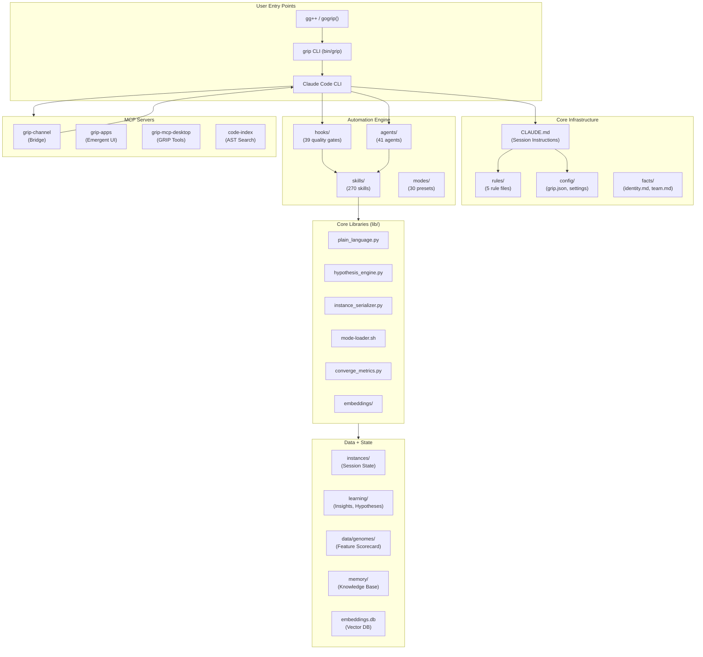
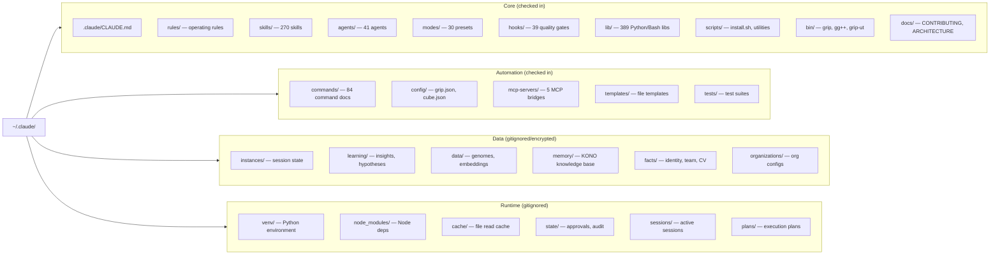
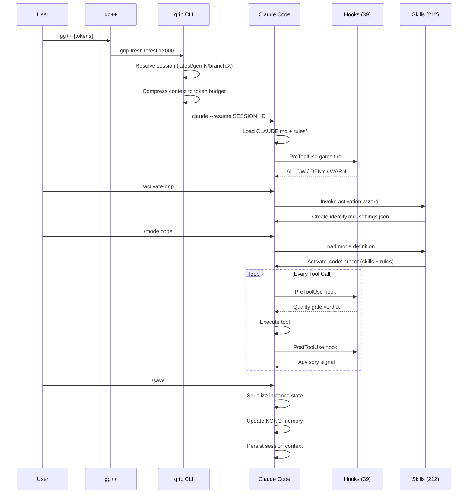
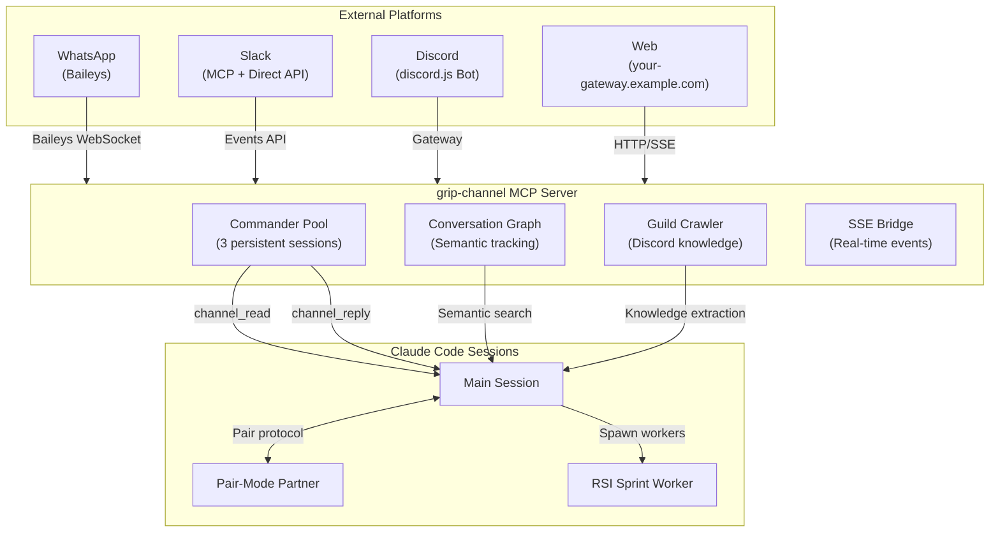
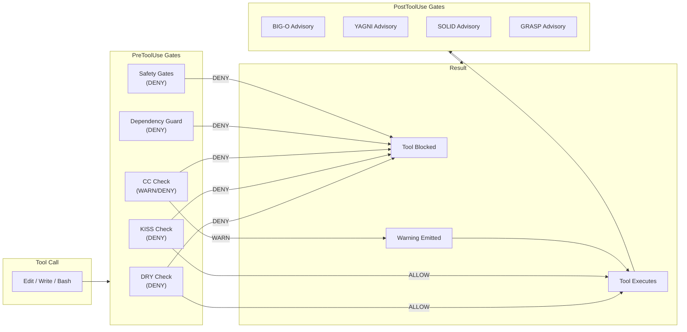
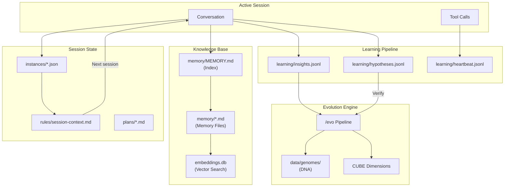

# GRIP Architecture

System-level architecture overview of GRIP (Guarded Response Interception Protocol).   
Auto-generated from repository topology analysis.

## System Overview

## Directory Layout

## Session Lifecycle

## Bridge Architecture (grip-channel)

## Quality Gate Pipeline

## Data Flow

## Component Counts

| Component | Count | Location |
|-----------|-------|----------|
| Playbooks (skills) | 212 | `skills/*/SKILL.md` |
| Workers (agents) | 39 | `agents/*.md` |
| Presets (modes) | 30 | `modes/definitions/` |
| Quality gates (hooks) | 39 | `hooks/*.py` |
| Commands | 67 | `commands/*.md` |
| Python libraries | 389 | `lib/*.py` |
| MCP servers | 5 | `mcp-servers/` |
| Rules files | 5 | `rules/*.md` |

## Key Design Principles

- **SOLID, GRASP, DRY, KISS, YAGNI, YSH, BIG-O** — enforced mechanically via hooks
- **Session continuity** — instance serialisation + context compression
- **Hypothesis-driven** — every improvement registers a falsifiable prediction
- **External scoring** — never self-score; use multi-model council
- **Plain language** — all output human-readable without GRIP knowledge
