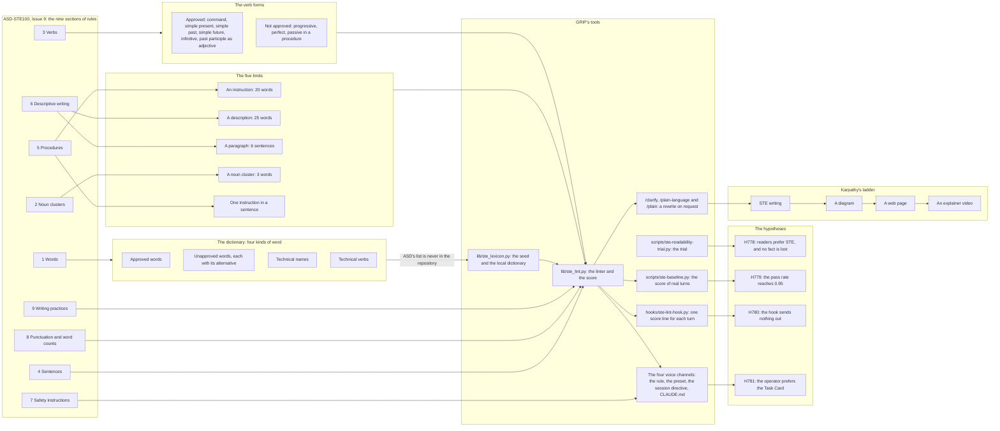

# ASD-STE100 in GRIP: a concept map

Simplified Technical English (ASD-STE100) is a writing standard for aircraft maintenance manuals. GRIP uses 80% of it as the measure of its own writing voice.

This page shows how the parts of the standard connect to the parts of GRIP. Read the graph from left to right. The standard is on the left. GRIP's tools are in the middle. The tests of the idea are on the right.

Two facts matter most. The first fact is that GRIP ships none of ASD's dictionary. The repository holds a builder, and each operator builds a local dictionary from their own copy of the standard. The second fact is that each claim has a test. Each hypothesis in the graph names the tool that measures it.

## How to read the graph

- **The nine sections** come from the overview sheet of the standard. The arrows show which section sets which limit.
- **The licence boundary** is the labelled arrow. ASD owns the dictionary. GRIP's repository holds a short seed that GRIP wrote and a builder. The local dictionary is built from the operator's own copy.
- **The linter** is the centre. Each other tool reads its score.
- **The ladder** is from Andrej Karpathy's note of 2 October 2026. Clear writing is its first step. A diagram, a web page and an explainer video are the next steps.

## Where each tool is

Each G box of the graph is one row of this table, under the same name.

| Tool | Where | What it does |
|---|---|---|
| The linter and the score | `lib/ste_lint.py` | It finds the faults in a text and gives the text a score. |
| The lexicon | `lib/ste_lexicon.py`, `config/ste/grip-seed.json` | It holds GRIP's seed and builds the local dictionary. |
| The rewrite on request | `/clarify`, `/plain-language`, `/plain` | It rewrites a text to the STE rules when you ask. |
| The baseline | `scripts/ste-baseline.py` | It scores the last 200 real turns and prints numbers only. |
| The hook | `hooks/ste-lint-hook.py` | It scores each turn and shows the operator one line. |
| The trial | `scripts/ste-readability-trial.py` | It asks model judges which version reads better and which keeps the facts. |
| The voice channels | `rules/canonical-output-style.md`, `output-styles/grip-canonical.md`, `hooks/caveman-session-default.py`, `CLAUDE.md` | They tell each session how to write. G6 in the graph names the same four files: the rule, the preset, the session directive, CLAUDE.md. |

## The two switches of the hook

The hook shows one line at the end of each turn. An example is `STE: 75% of sentences pass the sentence rules. 3 unapproved words, 1 sentence too long.`

- `GRIP_STE_VISIBLE=0` hides the line. The hook still writes its row of numbers to `logs/ste-lint-hook.jsonl`.
- `GRIP_STE_FEEDBACK=1` also gives the line to the model with the next prompt. This switch is off by default.

The second switch is off by default. A score that the model reads each turn changes how the model writes. The trial of hypothesis H778 did not confirm that change, so the operator decides.

## What the trial found

The trial ran on 2026-10-05, on 20 paragraphs from GRIP's own documents. Each paragraph had an STE rewrite.

Two model judges read each pair. DeepSeek v4 Pro preferred the STE version in 16 of 20 pairs. GPT-6 Astra preferred it in 19 of 20 pairs.

Each judge also answered three questions for each pair, from each version. GPT-6 Astra got 58 of 60 answers right from each version. DeepSeek v4 Pro got 55 right from the STE versions and 58 right from the originals.

The rule was registered before the trial: a loss of accuracy falsifies the hypothesis. So H778 is FALSIFIED by its rule. Two reviews of the method found that each lost fact is present in its rewrite. They also found that the rule is too strict for this test. A new trial needs a new hypothesis, and GRIP#7509 holds its design. The operator decides if the voice changes.

The records are in `docs/measurements/`. Their names start with `2026-10-05-ste-readability`.

GRIP is not certified or endorsed by ASD. ASD-STE100 is a trademark of ASD.
