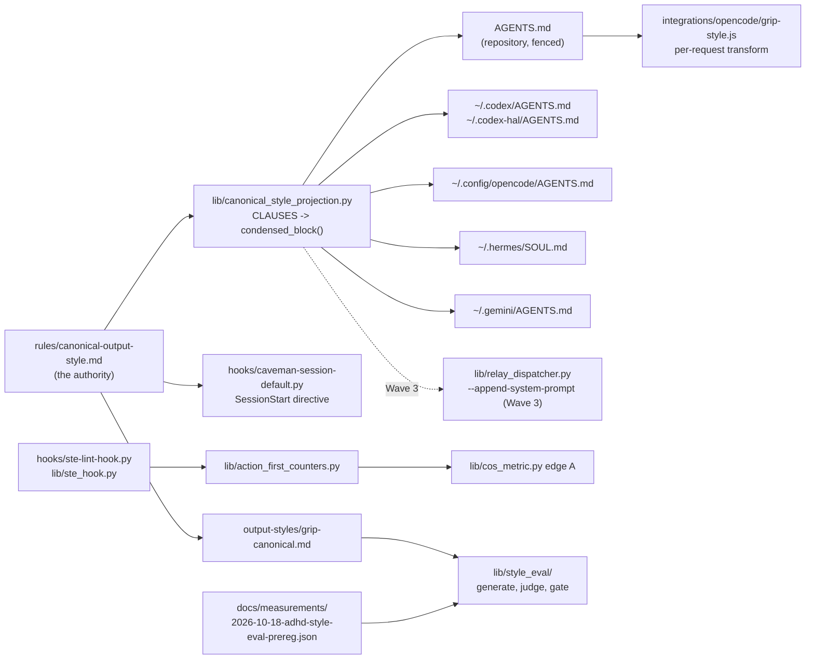

# Action-first shaping: how GRIP's Canonical Output Style subsumes i-have-adhd

Date: 2026-10-18. Plan: `plans/goal-absorb-knowledge-absorb-graph-grip-declarative-gizmo.md`.

The operator's ruling of 2026-10-18 (V>>) has four parts. Keep STE and the rest of the
style guide. Amend the style so the i-have-adhd project is fully integrated and subsumed.
Run the work as a `/converge` loop. Reach every harness GRIP launches.

This file is the record. It holds the subsumption map, which is the coverage contract,
and the rejected parts with their reasons. It also holds the delivery matrix, the harness
topology, the Roundtable's verdict and seal, and the provenance. The rule itself,
`rules/canonical-output-style.md`, changes in Wave 2 and does not restate this file.

## The source, pinned

`ayghri/i-have-adhd`, MIT, version 0.4.1, head `1ecea1993b7fce257ffbd686c070948b5e07eda6`
(2026-10-07), 57,563 stars at the time of the stealth analysis. GRIP takes influence and
never forks: no file of the source is vendored, and no clause names a medical condition
as a reader label. The clauses are named by what they do. The source's own CONTRIBUTING
forbids implying a diagnosis, and GRIP keeps that line.

The source has four layers of technology. T1 is the contract: five reader facts, ten
rules, six overrides, a pre-send check and a persistence clause with two stop phrases.
T2 is persistence per harness: a SessionStart hook, a per-turn system-prompt transform
and a re-injection after compaction. T3 is distribution: one canonical file, a condensed
always-on block, a mirror-sync check and a load check per harness. T4 is proof: fourteen
cases, a weighted rubric, a paired blind judge, a release gate, an isolated runner and a
six-turn persistence scenario.

## The subsumption map

Every row ends with a clause in the rule, a mechanism where one is named, and a test.
The map is the DONE predicate for "fully subsumed". Counters never edit a turn. They
measure it. Rows marked Wave 2 wait for the STE trial's arm report
(`docs/measurements/2026-10-14-ste-trial-prereg.json`, look 2026-11-01T13:00Z).

| Element | Disposition in the Canonical Output Style | Mechanism and test | Wave |
|---|---|---|---|
| F1 to F5 reader facts | ADD a short "why" paragraph under "The canonical style", attributed to the source | prose; each eval case names the facts it probes (`lib/style_eval/cases.jsonl`, `probes`) | 2 |
| R1 lead with the action | AMEND the `/tldr` clause: the first line is the action, the win or the fact | `action_first_counters.first_line_ok`; parity test across rule, preset, directive, block | 1 (counter), 2 (clause) |
| R2 numbered bounded steps | AMEND the instruction-list clause: one bounded action a step, the fewest steps that work | STE `one-instruction` counts today; a "two and then" counter follows | 2 |
| R3 one next action under two minutes | KEEP the closer; ADD the first two-minute slice of a longer `(yours)` step | `lib/next_step_router.parse`; parity test | 2 |
| R4 suppress tangents | ADD: a second issue is raised once, at the end, as a deferred item, never on the closer | `action_first_counters.sidebars` | 1 (counter), 2 (clause) |
| R5 restate state every turn | ADD one position line, `Step N of M done: X.`, never an invented total | the harness task tool holds the checklist; a progress-line counter follows | 2 |
| R6 concrete estimates | NARROW to any step the reader waits on, with its basis; an estimate with no basis is dropped | a vague-estimate counter follows | 2 |
| R7 wins visible | AMEND EFFECT and the recap: what now works, plus a try-it line | try-it presence on shipped-work cards | 2 |
| R8 matter-of-fact errors | NARROW: location, symptom, then the cause with evidence, or a safe reversible remedy with the cause marked unknown, or the next measurement | a drama-phrase counter follows | 2 |
| R9 cap lists at five | KEEP six; ADD the source's sentence that the cap shapes presentation only | the six-bullet test | 2 |
| R10 no preamble, recap narration, closers | AMEND `lib/cos_metric.py` edge A with the source's phrases; narration defined mechanically | `action_first_counters` opener, closer, recap_narration; metric mutants | 1 |
| O1 explain requests | KEEP expansion on request; ADD headings for skimming | none new | 2 |
| O2 destructive | KEEP (Auto-Clarity rail) | existing | kept |
| O3 debug spiral | ADD both triggers: three failed fixes or three "still broken" reports | the eval's six-turn scenario | 1 (case), 2 (clause) |
| O4 one clarifying question | KEEP, the `/hitl` way | existing gates | kept |
| O5 the task wins, the shape stays | KEEP: ranked options with trade-offs, recommendation first | existing gates | kept |
| O6 harness wins | KEEP; the projected block carries the sentence | `lib/canonical_style_projection.HOST_OUTRANKS`, projection test | 1 |
| P1 to P5 pre-send deletions | ADD to the rule as the writer's discipline; MECHANISE as row-only counters | `lib/action_first_counters.py`, FIRE and QUIET corpora, one mutation per detector | 1 |
| P6 first and last line | MECHANISE with a stated classifier: substantive when a closer parses or four prose sentences | `is_substantive`, `first_line_ok`, `last_line_ok` | 1 |
| PS1 persistence | KEEP: the SessionStart binding carries no narrowing matcher | projection test reads `settings.json` and the registry | 1 |
| PS2 stop phrases | `stop adhd mode` becomes a synonym of `normal mode`; a session marker survives compaction | marker round trip | 2 |
| T2 persistence per harness | the delivery matrix below; the OpenCode per-turn transform is first-class | `integrations/opencode/grip-style.js` | 1 |
| T3 condensed block, sync, load check | `lib/canonical_style_projection.py`, one generated block in a fenced span, idempotent | parity and drift tests; `bin/grip-harness style` | 1 |
| T4 proof | `lib/style_eval/`: cases, rubric, isolated runner, blind two-judge grading, the registered gate | `tests/test_style_eval.py`; the registration | 1 |

## Rejected, with reasons

The name and any medical framing were rejected. The clauses are named by what they do,
and a reader label of that kind is a claim about a person. A separate opt-in mode, plugin
or fork was rejected, because the operator ruled subsumption. A same-family judge was
rejected under `rules/exogenous-anchor-law.md`.

Unconditional estimates, and a cause named before its evidence, were rejected under
`rules/r0-critical-thinking.md` and the N=14 memory on naming the cause after the
measurement. The cap of five was rejected, because the six-bullet cap was ratified on
2026-08-24. The source's issue 96 records the loophole: the cap read as permission to drop
items. The sentence that the cap shapes presentation only closes it.

## The delivery matrix

The Roundtable refuted one AGENTS.md block as the delivery for every harness. Content
generation is one source. Delivery is per harness. All five harnesses are installed on
the machine that built this.

| Harness | Persistent surface the block is written to | Native mechanism | Post-turn check |
|---|---|---|---|
| Claude Code 2.1.301 | `output-styles/grip-canonical.md` and the SessionStart directive (Wave 2) | the output style in the system prompt; the directive on every SessionStart source | `hooks/ste-lint-hook.py`: the row (Wave 1), the line (Wave 2) |
| Codex 0.156.1 | `$CODEX_HOME/AGENTS.md` for every Codex home, fenced | the global AGENTS.md at session start | none today |
| OpenCode 2.0.20 | `~/.config/opencode/AGENTS.md`, fenced, plus `integrations/opencode/grip-style.js` | the global rules file, and the per-request `experimental.chat.system.transform` with a compaction note | `tool.execute.before` only |
| Hermes 0.17.0 | `~/.hermes/SOUL.md`, fenced | the persona file, loaded every message | investigated in Wave 3 |
| agy 1.2.8 | `~/.gemini/AGENTS.md`, fenced | the context file `context.fileName` names | none; whether this is the file agy reads is UNVERIFIED until Wave 3 |
| Relay (`claude -p`) | `--append-system-prompt`, when Wave 3 shows headless mode ignores the output style | `lib/relay_dispatcher.build_argv` | none |

Measured on 2026-10-18: `bin/grip-harness style` wrote the block into all five surfaces.
A second run reported every surface unchanged. Each surface carries exactly one opening
and one closing marker.

## The topology: one canonical file, fourteen adapters

Fourteen adapters read one canonical file:

- the preset and the SessionStart directive (Claude Code).
- the generator's core and the repository block.
- the two Codex homes.
- the OpenCode rules file and the OpenCode plugin.
- the Hermes persona and the agy context file.
- the relay prompt (Wave 3).
- the hook's counters and the metric's edge A.
- the eval harness.

Every arrow is a generated or tested derivation, never a hand copy. The one hand copy
found on the machine, the v8.0.0 instructions in `~/.codex/AGENTS.md`, sits outside the
fence and is a deferred item.

## The Roundtable verdict

The Knight's Roundtable sat on 2026-10-18 with GPT-6 Astra advising. DeepSeek v4 Pro,
Grok 4.5 and Groq gpt-oss-120b deliberated, Gemini 3.1 Pro judged, and no Anthropic model
was called. The seal is `f2f95ad543163b2f` and the IDR leaf is `precog-1792288600-ccced8cf`.
Re-verify with `grip-sovereign-council --verify f2f95ad543163b2f`. The judge chose Grok
4.5's answer. DeepSeek v4 Pro and Groq were cut off by their token budgets.

Read for substance, the sitting changed the plan in six places. On R6 and R8 the position
STANDS on no cause without evidence. It is WEAKENED on the claim that the source's
RESULTS.md asked for the fix, and on the unknown-cause, known-remedy case. Both are
fixed in the map. On P6 the position is WEAKENED, because the substantive classifier was
unspecified, and it is now stated. On R5 it is WEAKENED on the cap's scope and an invented
total, and both are fixed.

On T3 the position is REFUTED as one AGENTS.md block for every harness, and the delivery
matrix replaces it. On sequencing it is WEAKENED, because Wave 1 had to be shown
treatment-free. The exposure audit in the plan does that, and the memory absorb moved to
Wave 2. On the gate, Grok's paired no-new-blocker rule is adopted, with totals reported
and never gated.

A premise advisory fired on the seed, where the source's failed gate was asserted to
show its threshold wrong without a reproduction. The council did not take that failure
as proof, and the adopted gate rests on paired identity, not on that failure.

## What Wave 1 shipped

- GRIP#8561 and GRIP#8573: `lib/action_first_counters.py`, nine row-only counters in
  the STE hook's log row, with `docs/measurements/2026-10-18-action-first-counters.md`.
  Hypothesis H-AF-1 says openers and closers each fire on fewer than 5% of substantive
  rows before the look. Above 20% the live voice already violates the bans.
- GRIP#8572: `lib/cos_metric.py` edge A widened with the shared phrase tuples.
- GRIP#8574: `lib/canonical_style_projection.py`, the delivery matrix, the OpenCode
  per-request transform, the repository block and its drift test.
- GRIP#8577: the eval harness and its registration (`lib/style_eval/`,
  `docs/measurements/2026-10-18-adhd-style-eval-prereg.json`, hypothesis H-ADHD-1,
  ledger id H842). The id was H834 until GRIP#8588 took it in the same hour.
- This record and the stealth analysis
  (`docs/measurements/2026-10-18-i-have-adhd-anywhere-report.md`).

## Deferred items

- The stale hand copy of GRIP's instructions in `~/.codex/AGENTS.md` (v8.0.0, a `~/.Codex`
  typo): fold into a generated projection or retire it.
- `rules/output-tier-default.md` still labels `caveman_plain` as DEFAULT while
  `lib/output_tier.py` has `simple`.
- A post-turn check for Codex and Hermes.
- Whether agy reads `~/.gemini/AGENTS.md`: measured in Wave 3.

## What Wave 2 shipped, and the gate that did not run

The arm report was run and read on 2026-11-05 at 11:46 UTC. It was INCONCLUSIVE on
both factors, at 48 of the 90 sessions the registration needs. V>> then asked for Wave 2
to go ahead without waiting for the extended look of 2026-11-08.

The registered evaluation (H-ADHD-1, ledger H842) did not run. Its pinned runner,
Sonnet 5.5, answered `stop_reason: refusal` on the GRIP conditions, and the live
baseline was among them. No row set completed, nothing was graded, and no verdict
exists. On 2026-11-08 V>> chose to open the pull request without that gate. AGORA,
Codex and the tests review it, and the registration's falsifiers still apply after it
lands. GRIP#8998 tracks the evaluation and the three items below.

Wave 2 shipped these changes:

- The clauses in `rules/canonical-output-style.md` and `output-styles/grip-canonical.md`.
  They cover the action first, the step shape, the position line, the error shape,
  estimates with a basis, the forbidden openers and closers, and the pre-send check.
- The same clauses in the SessionStart directive and in the projected block of
  `lib/canonical_style_projection.py`.
- `stop adhd mode` as a synonym of `normal mode`, kept through a compaction by
  `hooks/full-prose-marker-hook.py` and `lib/full_prose_marker.py`.
- A runner that drops the launching session's own settings and identity, which are every
  `CLAUDE*` variable and the `ANTHROPIC_*` model aliases (`lib/style_eval/generate.py`,
  `isolated_env`). It is a denylist: the rest of the environment passes through, and
  `tests/test_style_eval_runner_env.py` pins each credential case. The paid key, `ANTHROPIC_API_KEY`, reaches
  a row only under `GRIP_CLAUDE_ALLOW_PAID=1`, the opt-in
  `rules/claude-cap-moves-to-the-next-subscription.md` names. A gateway URL is kept with its
  own token, `ANTHROPIC_AUTH_TOKEN`, because the gateway cannot authenticate without it.
  With no gateway URL, that token also needs the opt-in.
- `tests/test_canonical_action_first_parity.py`, `tests/test_full_prose_marker_hook.py`
  and `tests/test_style_eval_runner_env.py`.
- The evaluation's baseline, frozen as `lib/style_eval/baseline-before-wave-2.md`, because
  this change replaces the live preset. The registration's amendment of 2026-11-08 records
  its sha256, so the deferred run compares the old voice with the new one.

These items stay open under GRIP#8998:

- The one-line summary in `CLAUDE.md`, in its own small pull request.
- PR-E2, the visible line, under its own registration.
- The memory absorb of the source.

## Provenance

V>> (operator, direction and rulings). Claude Fable 5.1 (the plan, the subsumption map,
the position put to the Roundtable, Wave 1's code and this record). Claude Sonnet 5.5
(three Explore agents and one Plan agent, the corpus table the counter tests follow).
Knight's Roundtable: GPT-6 Astra (advisor), DeepSeek v4 Pro, Grok 4.5, Groq gpt-oss-120b
(speakers), Gemini 3.1 Pro (judge), seal `f2f95ad543163b2f`. Source: ayghri/i-have-adhd,
MIT, Ayoub G. and contributors, v0.4.1 at `1ecea1993b7fce257ffbd686c070948b5e07eda6`.
Claude Opus 5.5 wrote Wave 2: the clauses, the marker hook, the runner fix and the
section above.
