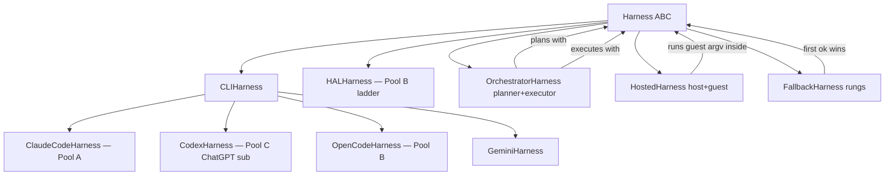

# Harness-in-Harness — agentic runtimes as substitutable types

`lib/harness/` makes an agentic RUNTIME (Claude Code, Codex, OpenCode,
Gemini CLI, a bare HAL provider call) a first-class polymorphic type, and
makes COMPOSITION of runtimes (orchestrator/executor, hosted, fallback)
just more instances of the same type. Codex-inside-Claude-Code — the
OpenAI `codex-plugin-cc` pattern — becomes one concrete instance of a
general capability: **any harness in any harness**, in true Liskov
fashion.

North star (V>> 2026-07-14): *"Claude Code in Codex. Gemini in OpenCode.
OpenCode in Hermes … another abstraction layer here, OOP conformant —
polymorphic and with inheritance."*

## The structural mapping (Gentner-sound, not decorative)

The design lifts the proven `lib/agora/speaker.py` abstraction exactly
one level. The mapping is systematic and relational — each relation on
the left maps to the same relation on the right:

| Speaker layer (conversation actors) | Harness layer (agentic runtimes) |
|---|---|
| `Speaker.send_message(Message) -> Response` | `Harness.run(Task) -> HarnessResult` |
| `Response.id` echoes `Message.id` | `HarnessResult.id` echoes `Task.id` |
| `kind` discriminator (`llm/agent/team/agora`) | `kind` discriminator (`claude-code/codex/opencode/gemini/hal/orchestrator/hosted/fallback`) |
| `TeamSpeaker`/`AgoraSpeaker` compose Speakers | `OrchestratorHarness`/`HostedHarness`/`FallbackHarness` compose Harnesses |
| Agora-in-Agora recursion, cycle-guarded | Harness-in-harness recursion, cycle-guarded |
| LSP proven by parametric tests | LSP proven by parametric tests **and enforced at runtime** |

In both domains `kind` flows from class identity — one class per kind,
declared as a class attribute — never from per-instance configuration.

### Deliberate divergences (the mapping's honest boundary)

Three places where the target domain intentionally departs from the
source, named as divergences rather than smuggled as "the same pattern"
(sharpened by a gentner-enforcer pass + a sovereign-council critique,
IDR `precog-1784057005-5f4a2b79`):

1. **`Task` ⊃ `Message`.** A Message is a pure envelope; a Task carries
   `timeout_s` because scheduling is intrinsic to runtimes. The mapping
   is relational (send/echo/kind/compose/recurse), not a claim of
   field-level isomorphism.
2. **Role-named composite slots.** Speaker composites hold homogeneous
   member lists; `OrchestratorHarness` and `HostedHarness` name roles
   (planner/executor, host/guest), and Hosted's guest requires the
   narrower CLI-invocable interface. That is an ISP constructor
   precondition on the composite — LSP binds method contracts used
   through the supertype interface, and constructors are not
   substitution surfaces; every composite remains fully substitutable
   AS a Harness.
3. **Trust-model inversion.** Speaker trusts subtypes and verifies by
   tests; `Harness.run` verifies at run time and raises
   `HarnessContractViolation` on a lying subtype. This is a deliberate
   governance upgrade for a boundary that spawns real subprocesses with
   real spend — loud-at-the-boundary beats silent downstream lying, and
   it complements (not replaces) the parametric tests: tests sample the
   input space, the runtime check covers every real dispatch.
   `HarnessResult` is honest by construction: `ok=True` cannot carry
   empty content, `ok=False` cannot carry an empty error.

## OOP conformance

- **Inheritance**: `Harness` (ABC, template method `run`) → `CLIHarness`
  (shared subprocess execution) → per-runtime leaves; composites inherit
  `Harness` directly.
- **Polymorphism**: callers hold `Harness` only; the parametric LSP suite
  (`tests/test_harness_lsp.py`) proves a subtype-blind caller works
  across all eight built-in types.
- **LSP**: preconditions never strengthened (every subtype accepts the
  same baseline `Task`); postconditions never weakened (structural in
  `HarnessResult`, enforced in `run`).
- **ISP**: CLI-invocability (`as_argv`) is a narrower surface than
  `Harness`; only `HostedHarness` requires it — of its *guest*, as a
  composite constructor precondition, never of the base type.
- **DIP**: subprocess runners and the HAL infer callable are injected;
  the whole test suite is hermetic (no real CLI, no network).
- **OCP**: `@register` + `make(kind, ...)` — the next runtime ("Hermes,
  etc.") lands as one subclass + one decorator, zero caller changes.

## Composition shapes

- `OrchestratorHarness(planner, executor)` — the orchestrator/executor
  split: plan with one runtime, execute with another, both sub-results
  preserved so the caller inspects the executor's work before accepting
  it (never blind-trust the executor).
- `HostedHarness(host, guest)` — TRUE nesting: the guest's command line
  runs inside the host's sandbox/tool loop. Symmetric by construction:
  Codex-in-Claude and Claude-in-Codex are the same class with arguments
  swapped.
- `FallbackHarness(rungs)` — first-ok-wins ladder; the HAL sentinel
  shape at harness granularity (a rate-limited rung fails over, never
  blocks).

## Spend pools (extends the Two-Pools moat)

| Pool | Runtime | Weekly-limited? |
|---|---|---|
| A — Anthropic harness | `ClaudeCodeHarness` (`claude -p`) | YES (`/usage`) |
| B — HAL providers | `HALHarness`, `OpenCodeHarness` | No (~$0, sovereign) |
| C — OpenAI ChatGPT subscription | `CodexHarness` (`codex exec` via `bin/grip-codex-ladder` rung 1) | Separate OpenAI limits |
| D — Kimi Code subscription | `KimiCodeHarness` (`kimi -p` via `bin/grip-kimi`) — and only when the CLI's own `/login` (Kimi Code OAuth) provider answers. On the `hal` route `lib/kimi_hal_route.py` writes, the same leaf bills **B** (metered Moonshot behind the gateway). **Unarmed** until the keychain entry `grip-kimi-coding` exists (`lib/next_move.py::pool_d_armed`) | Its own weekly quota + rolling 5-hour window |

C and D are both third-party subscription quotas, but they are not one pool: C
is the ChatGPT plan reached by the Codex ladder's `forced_login_method=chatgpt`
rung, and D is Moonshot's Kimi Code plan at `api.kimi.com/coding/`. A pool
names whose allowance is drawn down, never which harness ran the call or which
model family answered, so a Kimi id on the ChatGPT rung would be a category
error. Codex pointed at the HAL gateway bills B, not C (`bin/grip-codex:59-76`),
and the metered Kimi API at `api.moonshot.ai` is a B backend, not D. Ruled by a
sealed non-Anthropic sovereign council, seal `e49c00c214c500be`, IDR leaf
`precog-1788805766-c58539b1`.

Reference: `rules/pool-a-offload-routing.md` + `GRIP-Two-Pools-One-Gateway.pdf`
(the moat doc this extends from two pools to N). Routing guidance from the
absorbed orchestrator/executor pattern (KONO `absorbed_web_c45fc0a6.md`):
planning/critique on the expensive orchestrator, heavy implementation on
the executor pool. Model-tier claims in that post (DeepSWE scores, per-task
costs, the July-19 tier availability) are **unverified third-party claims**
— which is why routing lives in constructor arguments and configuration,
never hardcoded model tables.

## Adapter wave registry (2026-07-17 — 19 CLI coding-agent adapters)

Every adapter carries research provenance (source URL + date verified +
confidence) and a capability-floor default in its module docstring; tests
inject fake runners (no real binaries, no network). Widening is always an
explicit constructor choice, never implicit.

| kind | binary | default non-interactive shape | confidence |
|---|---|---|---|
| `shell-gpt` | `sgpt` | `sgpt "<prompt>"` (Q&A only; `--shell` widening always pairs `--no-interaction`) | high |
| `fabric` | `fabric` | `fabric --pattern summarize "<prompt>"` (pure text transform) | medium |
| `open-interpreter` | `interpreter` | `interpreter exec --sandbox read-only "<prompt>"` (Codex-fork lineage; legacy 0.4.3 REPL deliberately NOT adapted) | high |
| `continue-cli` | `cn` | `cn --readonly -p "<prompt>"` | high |
| `goose` | `goose` | `goose run -t "<prompt>" --no-session` (env runner sets `GOOSE_MODE=auto` only when unset; no read-only mode exists — floor is containment) | high |
| `openhands` | `openhands` | `openhands --headless -t "<prompt>"` (headless hardcodes always-approve upstream; no confinement flag exists — documented, not faked) | high |
| `plandex` | `plandex` | `plandex tell "<prompt>" --skip-menu --no-exec` (never `--apply` by default) | high |
| `kilo` | `kilo` | `kilo run --auto "<prompt>"` | high |
| `metagpt` | `metagpt` | `metagpt "<idea>" --n-round 5 --investment 3.0` | high |
| `chatdev` | `python3` | `run.py --task … --name …` in a caller-supplied checkout | high |
| `gpt-pilot` | `python3` | `main.py --initial-prompt …` in a caller-supplied checkout | high |
| `devika` | `python3` | server launch only — NO one-shot mode exists upstream (adapter refuses to fake one; upstream binds `0.0.0.0:1337` unauthenticated — firewall if run live) | high |
| `agent-zero` | `python3` | stdin-piped `run_cli.py` in a caller-supplied checkout | medium |
| `swe-agent` | `sweagent` | `sweagent run --agent.model.name=… --problem_statement.text=…` | high |
| `omnigent` | `omnigent` | `omnigent run --harness codex -p "<prompt>"` (meta-harness — a harness-of-harnesses peer of our composites) | medium |
| `codewhale` | `codewhale` | `codewhale exec "<prompt>"` (ex DeepSeek-TUI) | high |
| `agy` | `agy` | `agy -p <prompt> --sandbox --mode plan` (gemini-cli lineage) | medium |
| `qwen-code` | `qwen` | `qwen -p <prompt> --approval-mode plan` | high |
| `pi` | `pi` | `pi -p <prompt> --tools read,grep,find,ls` | high |

Added after that wave:

| kind | binary | default non-interactive shape | confidence |
|---|---|---|---|
| `dsh` | `dsh` | `dsh --profile headless "<prompt>"` (env runner pins `DSH_PERMISSION_MODE=read-only` — a real sandbox floor, unlike goose, so it is set unconditionally rather than `setdefault`; prompts starting with a dash are rejected upstream, and every dispatch persists a session under `$DSH_HOME/sessions/`) | high |
| `kimi-code` | `kimi` (through `bin/grip-kimi`) | `kimi -p "<prompt>"` — the vendor's documented headless form (getting-started, text render :55-56). The mirrored docs document no read-only flag and no environment variable that narrows approval; the documented default already confirms before file writes and shell commands (:70), so the floor is "pass nothing beyond `-p`" and the shim adds no widening switch. Whether a `-p` run exits on its own with no TTY, and whether stdout carries only the answer, is UNVERIFIED-until-installed — `bin/grip-kimi-verify` reports each as PASS / FAIL / NOT-INSTALLED | high for the argv shape (vendor docs read as text, 2026-09-07); UNVERIFIED-until-installed for headless exit and stdout purity |

## Two registries, two jobs (2026-08-19)

This page describes the DISPATCH side: `lib/harness/` runs a harness
one-shot and hands back a `HarnessResult`. There is a second, separate
registry for the LAUNCH side — `lib/grip_harness_picker.HARNESS_REGISTRY`
— and it is what `gg++ <name>` and the launch menu read.

They answer different questions, and neither subsumes the other:

| | `lib/harness/` | `grip_harness_picker` |
|---|---|---|
| question | how do I run one task on it? | can I open a session in it? |
| argv | non-interactive (`-p`, `exec`, `run -t`) | interactive |
| membership | every runtime worth dispatching | only ones with a real session |
| capability floor | read-only allowlists | inherits the harness's own |

Until 2026-08-19 the launch registry held six entries while this page
listed nineteen adapters, so "GRIP supports N harnesses" and "you can
open six of them" were both true at once and nothing showed the gap. The
launch registry now covers the same ground, with two distinctions carried
in the data rather than in prose:

- `interactive: False` — installable, and dispatchable through this page's
  layer, but it has no session mode, so the launch menu does not offer it
  (fabric, sgpt, metagpt, plandex, swe-agent, omnigent).
- `install: {"manager": "manual", "reason": ...}` — no package was found
  that provably ships that binary, so `bin/grip-harness-install` prints
  the reason and installs nothing rather than running a guess.

`bin/grip-harness-install --list` renders both. Every automatic entry was
verified against its canonical registry (npm registry JSON, PyPI JSON,
`brew info`) rather than from recall, which mattered more than expected:
`brew install goose` fetches a database-migration tool, npm
`@mariozechner/pi` ships `pi-pods`, and npm `omnigent` ships
`omniagent` — three plausible commands, each wrong in the same quiet way,
installing cleanly and failing only at launch.

One consequence worth stating plainly: `gg++` resolves its code from
`$GRIP_DIR` (`~/.grip`), so a registry edit made in a worktree is not live
for the operator until it reaches the branch that tree is on
(`rules/shared-tree-is-not-canonical.md`).

## Claude Code as a guest of a non-Anthropic model (2026-09-07)

`gg++ claude --kimi` makes Claude Code a harness for a model family HAL
serves on `/v1/messages`, and it has two paths. The default rides the
gateway: `GRIP_INFINITE=1 gg++ claude --kimi` exports the whole vendor tier
map (`GRIP_1M_MODEL=kimi-k3[1m]` as the `--model`, the
`ANTHROPIC_DEFAULT_*_MODEL` and subagent tiers, the catalogue's compact
window, the family's effort default) as validated `KEY=VALUE` lines, keeps
`ANTHROPIC_BASE_URL` on `http://127.0.0.1:4010`, and leaves the credential
to the gateway — so the launch is witnessed, cost-tracked and
failover-capable, and it refuses (exit 2) rather than fall open to Anthropic
when the gateway is not up, because "direct to Anthropic" is a 404 on the
first message for a Kimi id. The opt-in `--direct` (`gg++ claude --kimi
--direct`; for Codex, `gg++ codex --kimi --direct` through a
`~/.codex/kimi-direct.config.toml` profile overlay layered with
`-p kimi-direct`) talks to the vendor's own endpoint with the key read from
keychain `grip-moonshot` for that one exec and never written; what it
forfeits is exactly the gateway's value — no HAL witness row, no cost row,
no failover — which is why the launch card says so on every such launch and
why it is never a fallback. Two limits, stated rather than left to be found:
until HAL's Anthropic same-wire egress lands
(`feat/kimi-w2-anthropic-same-wire`), the gateway cross-wires the Anthropic
body to chat-completions and drops `thinking` / `output_config` /
`cache_control`, so full-fidelity Claude Code → HAL → Moonshot is that PR's
deliverable, not this one's; and Claude Code applies a settings-file `env`
value over the launch environment (Anthropic settings reference, `env`: "A
value here overwrites the same variable exported in your shell"), so GRIP's
shipped `settings.json` pin `CLAUDE_CODE_EFFORT_LEVEL=max` overwrites the
family's effort — the launcher names the pin on stderr rather than
pretending the level arrived. Launch surfaces: `lib/shell-functions.sh`
(`gogrip`), `bin/gg++`, `lib/grip_launch_args.py` (`--help`); seams:
`bin/grip` (`_grip_family_env`, `_grip_codex_direct_env`) and
`lib/grip_harness_family.py` (`claude_env`, `claude_env_lines`,
`write_codex_direct_profile`, `settings_env_pins`).

## Unified dispatch log (the cross-model session log)

Every `run()` appends one line to `<claude_dir>/logs/harness-dispatch.jsonl`:
`ts, kind, harness_id, task_id, ok, duration_ms, content_sha12, error_head`.
Content is hashed, never logged raw (redaction discipline). This answers
the multi-model context-tracking overhead: one log, all runtimes, all
pools.

## Absorbed from DSH (2026-08-19)

The DeepSeek Harness checkout at `~/deepseek-harness` was read for patterns
worth taking. It cannot accept external pull requests, so nothing flows back
and nothing is copied verbatim — anything adopted is re-derived in GRIP's own
terms. Two candidates were assessed. One was already built here and needed
wiring, not building. The other was declined outright.

### Taken: the generated-artifact freshness gate — as WIRING, not a rebuild

DSH pairs every generator with a `--check` twin: `gen-tool-catalog` writes,
`verify-tool-catalog` runs the same script with `--check`, which renders in
memory, compares byte-for-byte against the committed file, and exits non-zero
when they differ (`scripts/gen-tool-catalog.ts:735-744`). Ten `verify-*` scripts
in its `package.json` follow that shape, grouped for CI in `scripts/run-gates.ts`.

**GRIP already had this three times over**, which is the finding that mattered:

| GRIP surface | Guards |
|---|---|
| `scripts/generate-reference-docs.py --check` | `docs/COMMANDS.md`, `docs/AGENTS.md` |
| `lib/hooks_registry.py generate --check` | hook registry outputs |
| `tests/test_capabilities_line_is_true.py` | the six-count stats line |

Each renders in memory, compares to the committed artefact, and fails when
stale — structurally the same gate. Rebuilding a check engine would have been
duplication of something that already worked.

What was missing was the wiring, and the cost of missing it was visible on
`origin/main` the day this was written. `.github/workflows/validate.yml` is the
only pull-request gate; it ran shellcheck, py_compile, markdownlint, structure,
secrets and the CC ratchet, and no pytest at all. A search of `.github/` for
`--check`, `stale` or `freshness` returned nothing. The generators were correct;
nobody called them. So all three gates were **red on main**:
`rules/system-capabilities.md` claimed Skills 318 / Rules 62 / Hooks 109 against
308 / 61 / 110 real, and `docs/COMMANDS.md` claimed 391 commands against 389.

The `generated-artifacts` job now runs all three on every pull request, with
`CLAUDE_DIR` pinned to the checkout.

Three defects had to be fixed first, and each is the same shape — **something
resolved its root separately from the artefact it was grading**:

1. `hooks/doc-drift-hook.py` hardcoded `Path.home() / ".claude"` instead of the
   `get_claude_dir()` shim `rules/path-portability.md` mandates. Because
   `~/.claude` is a symlink onto a shared tree that launchd agents run from
   (`rules/shared-tree-is-not-canonical.md`), a skill written in a worktree made
   the hook regenerate the *shared* tree from the shared tree's own inventory —
   leaving the worktree's artefact stale and dirtying a tree another session was
   using. The numbers it wrote were self-consistent, which is why nothing
   complained. What the fix buys, precisely: the root is now *choosable*, so CI
   pins it to the checkout. It does not make a worktree self-correcting —
   `get_claude_dir()` still falls back to `$HOME/.claude` and nothing in GRIP
   exports `CLAUDE_DIR` for a worktree (`lib/grip-worktree.sh` sets no
   environment at all).
2. `is_inventory_file()` matched skills, agents, commands and modes but never
   `/rules/*.md` or `/hooks/*.py`. Those two counts were stale *by construction*:
   no edit to either category could ever trigger the auto-fix. They are exactly
   the two fields that were measured wrong.
3. `scripts/generate-reference-docs.py` collected its rows from `GRIP_DIR` but
   asserted their count against a no-arg `count_inventory()`, which re-resolves
   `get_claude_dir()` at call time. Under pytest that is not hypothetical:
   `tests/conftest.py` points `CLAUDE_DIR` at an empty per-test directory, so the
   count came back 0 and the generator's own assert fired on a perfectly fresh
   document.

The third defect had a twin in the tests, and it is the sharpest lesson here.
`tests/test_reference_docs.py::test_commands_doc_is_fresh` was **green over a
genuinely stale document** — it compared this checkout's committed
`docs/COMMANDS.md` against a render of `~/.claude`, and the shared tree really
did have 391 commands. A test that grades the wrong artefact does not merely
fail to catch drift; it certifies it (`rules/tests-must-be-able-to-fail.md`,
shape 2). The suite now pins the generator's root to the checkout.

One thing genuinely new was taken from DSH: its `--check` failure output names
the first differing line and quotes both sides, turning a two-word failure into
a diagnosis without a local re-run. GRIP's printed a bare filename. The
reporting shape was ported; the comparison logic was already correct.

### Declined: the sealed state-directory lifecycle — nothing built

DSH tracks agent notes through lifecycle directories (`proposed`,
`implemented`, `rejected`, plus a frozen `archived`, per
`scripts/agent-note-tree.ts:12-22`) and seals the archive with a manifest of
`sha256:` digests, rejecting any changed or missing sealed entry against a
baseline read from git (`scripts/verify-archived-agent-notes.ts:87`).

Nothing was built for this, on three pieces of evidence rather than taste.

**GRIP already tried directory-as-lifecycle and its own code demoted it.**
`backlog/{archive,processing,rejected,reviewed}` are tracked but contain only
`.gitkeep`. Meanwhile `lib/backlog_manager.py:44-53` uses a different vocabulary
entirely (`inbox` / `processed` / `archived`), and line 267 states outright that
an item "can live in ``archived/`` while still carrying ``status: inbox``. The
authoritative source of truth is the JSON". Adopting the directory-as-lifecycle
model would re-import drift GRIP has already diagnosed and rejected.

**GRIP's seal is strictly stronger, and already applied to a repo artefact.**
`research/sigd-route-ots-anchor/manifest.json` carries a `forest_merkle_root`,
an `idr_leaf_content_addr`, an OpenTimestamps Bitcoin calendar receipt, and a
`tamper_control` block recording that the verdict flips to broken under
mutation. DSH's is an unsigned local `sha256:` with no external anchor.

**What DSH's manifest adds over plain git is defence against history rewrite** —
which GRIP already forbids by policy, and for tracked files git is itself the
content-addressed tamper-evident log, with the protected-branch merge trail as
the external anchor.

Scope of that decline, stated honestly: it covers the artefact classes examined
— `backlog/`, `plans/`, `docs/`, `rules/`, and the IDR forest. Whether
`projects/*/memory/` has an unclosed-lifecycle problem a state directory would
solve was not audited, and this does not clear it.

### Left open, deliberately

`README.md` carries no inventory counts, here or on `origin/main`. It had them
once (they were added with self-updating `<!-- grip-stats:KEY -->` markers), and
a later README rewrite removed the count column outright, replacing it with the
sentence "counts are generated, not hand-maintained" plus links to the generated
docs. Two writers still target those markers and correctly do nothing, and a
test demanded the markers exist — a premise no regeneration could satisfy.

Whether the README should show counts again is a product decision and was not
made. The test now guards the anti-drift intent in a form true under either
answer: a count stated in the README must be marker-tracked, and a marked count
must match the live inventory. Both limbs were proven able to fail.

## Absorbed from Kimi Code CLI (2026-09-07) — the `kimi-code` leaf

Moonshot's Kimi Code CLI was read from its documentation as text
(`https://www.kimi.com/code/docs/en/kimi-code-cli/…`; the installer at
`https://code.kimi.com/kimi-code/install.sh` was read and never executed) and
from the fleet's 213 `cli-*` findings over the same corpus, each re-read at its
locator before it was relied on. The CLI is **not installed** on the machine
that wrote this; nothing was reproduced live. The file set mirrors DSH exactly:
`lib/harness/kimi.py` (dispatch, plus its import in `lib/harness/__init__.py`,
without which `@register` never runs), `lib/grip_harness_picker.py` row
`kimi-code` (launch — `launch_argv: ("grip-kimi",)`, install `manual`, not in
`_WIREABLE`), `bin/grip-kimi` (shim), `lib/kimi_hal_route.py` (the route),
`bin/grip-kimi-verify` + `lib/kimi_boot_probe.py` (the boot proof), and four
hermetic test files that never spawn the binary.

### Taken: the provider lives in the CLI's own config file

The CLI reads providers from `~/.kimi-code/config.toml` and states that it "does
not fall back to shell environment variables for credentials" (providers page,
text render :42). DSH's reference-only `apiKeyEnv` is therefore not a mechanism
this CLI has, so the route carries the gateway's non-secret doorstop literal in
the documented first-priority `api_key` field, and the block sits between GRIP's
existing TOML fence (`lib/grip_harness.py::merge_managed_toml`), so an
operator's own `[providers.kimi]` from `/login` is never touched, a foreign
`[providers.hal]` outside the fence is refused rather than clobbered, and a
re-run rewrites nothing. Provider type `openai_responses` (:89-96) at
`http://127.0.0.1:4010/v1` — the Responses same-wire path `gg++ codex --kimi`
already uses; bare ids (`kimi-k3`, `kimi-k2.7-code`) because the CLI matches
capabilities "by model name prefix" (:41) and HAL maps the `kimi` prefix to
Moonshot. Both ids returned HTTP 200 on `/v1/responses` through the gateway on
2026-09-07 (4.24 s / 1.03 s), with `max_context_size` read from
`config/model_catalog.yaml`, never invented.

### Noted for later, not built: the ACP seam and the MCP client

`kimi acp` speaks the Agent Client Protocol — JSON-RPC over stdin/stdout, no
banner, logs to stderr (kimi-acp :30-32), `loadSession: true`, image prompts,
and `session/set_config_option` as the one programmatic model/thinking switch
anywhere in the corpus (:71). That is a future `HostedHarness` transport,
deliberately not used by this leaf. The CLI is also an MCP client (stdio, HTTP
and SSE) configured in `~/.kimi-code/mcp.json` and per-project
`.kimi-code/mcp.json`; project-level stdio entries "execute local commands when
a session starts" (mcp :76), and durable `[[permission.rules]]` exist in
config.toml (:80-88), but the mirror shows their pattern syntax only for
`mcp__<server>__<tool>` names, so no rule for built-in tools was written (that
would be an invented shape, `rules/no-stubs.md`).

### What stays UNVERIFIED until the operator installs it

Whether a headless `kimi -p` run exits after one answer with no TTY, whether
stdout carries only the answer, how a confirmation prompt resolves without a
terminal, and whether the CLI's Responses client and HAL's Responses façade
agree on every field. `bin/grip-kimi-verify` turns each into PASS / FAIL /
NOT-INSTALLED in plain words. The install itself — `curl -fsSL
https://code.kimi.com/kimi-code/install.sh | bash`, or the npm package
`@moonshot-ai/kimi-code`, which registry.npmjs.org confirmed on 2026-09-07
ships bin `kimi` (0.41.0, node >=22.19.0) — is the operator's opt-in; the
registry row is `manual` for that reason, not for lack of verification.

## Honest boundaries

- **Host capability is explicit.** Hosting needs command execution in the
  host's surface: `ClaudeCodeHarness(tools=("Bash",))` is an opt-in
  widening; the default stays the read-only relay allowlist
  (`rules/untrusted-content-capability-lock.md`). Codex's default sandbox
  here is `read-only`; a real Claude-in-Codex run needs a wider Codex
  sandbox than autonomous sessions are permitted to grant themselves.
- **`available()` vs substitutability.** Gemini/Hermes availability is a
  runtime concern (`shutil.which`); substitutability is proven with
  injected runners regardless of what is installed.
- **HALHarness is a degenerate harness** (bare provider call, no tool
  loop) — substitutable, and documented as what it is. It is also the
  live HAL-in-HAL seam: the engine underneath may route to the VPS
  sovereign-council endpoint (ADR 0012 — a harness hosting a harness at
  the provider layer, already in production).
- **This layer routes; it does not sandbox.** Guests inherit the host's
  sandbox; GRIP's gates keep governing the outer session.
- **Injection surface, honestly stated.** The guest command is built
  with `shlex.join`, so a hostile `task.prompt` cannot break shell
  quoting (regression-anchored by a hostile-prompt round-trip test).
  The residual risk is PROMPT injection at the host LLM layer — an
  adversarial prompt may try to talk the host into doing something
  other than running the command. Mitigation is the capability lock:
  the host's sandbox/tool allowlist bounds the blast radius, which is
  why hosting never widens capability implicitly.

## Falsification

Wrong if: (a) a genuinely new runtime cannot be expressed as a `Harness`
subtype without distortion (the abstraction is not universal — narrow
it); (b) the runtime contract enforcement in `run()` ever has to be
bypassed by a legitimate subtype (the invariants are too strong); (c)
over ~10 real cross-runtime dispatches the unified log + compositions
are never consulted (theatre — fold back into ad-hoc subprocess calls).
Track: real dispatches per kind in `harness-dispatch.jsonl`.

## Provenance

Origin: V>> 2026-07-14 — Codex plugin install + the harness-in-harness
directive. Pattern lineage: `lib/agora/speaker.py` + `tests/test_speaker_lsp.py`
(the Speaker LSP suite this mirrors), `audit/scanners/lsp_scanner.py`
(L1 dogfood test), `rules/pool-a-offload-routing.md`,
`rules/untrusted-content-capability-lock.md`, ADR 0012.
