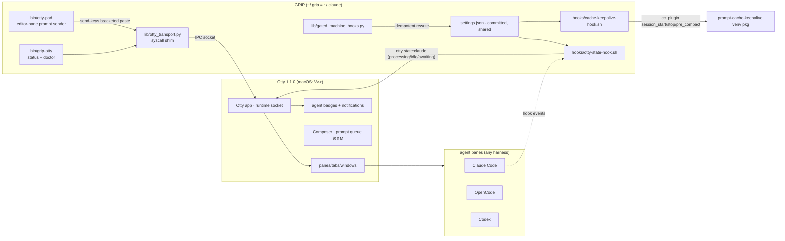

# Otty ⇄ GRIP/HAL/HAPPI Integration

Absorbed 2026-07-02 from docs.otty.sh (15-page parallel crawl, workflow
`wf_0eaa9ef6`) + live verification on Otty 1.1.0 on V>>'s Mac (the stronger
source — every CLI claim below was probed, not just read).

**What Otty is**: a GPU-native (Metal/DirectX, no Electron) terminal emulator
*built for code agents* — Claude Code, Codex and OpenCode are first-class:
per-pane agent lifecycle badges, a Composer, a prompt queue, send-to-chat,
cross-conversation history, session fork/branch. Commercial, macOS today
(Windows build not shipped yet — hence GRIP's detection gating). Control
surface: a CLI (`otty …`) over a runtime socket, `--json` everywhere.

## Topology (absorb-graph)

Windows teammates (F>>, A>>, K>>): `WRAP1`/`WRAP2` exit 0 in ~2ms (no
`/Applications/Otty.app`, no `venv/bin/python3`) — the committed settings.json
is identical for everyone, *behaviourally present only where the tools live*.

## The verified CLI surface (Otty 1.1.0, probed live)

| Primitive | Command | Gotchas learned live |
|---|---|---|
| List panes | `otty pane list --json` | `process` = live agent title (e.g. `⠐ Fix example build…`) — agent detection heuristic |
| Send a prompt | `otty pane send-keys --pane <id> --bracketed-paste -- "text" key:Enter` | **Disabled by default**: `otty config set ipc-allow-send-keys true` **AND** `otty config reload` (set without reload is a no-op in the running app) |
| Read a pane | `otty pane capture <id>` | `--lines N` = BOTTOM N rows; full capture for verification |
| Split | `otty pane split --direction right --command … --title … --no-focus` | Returns NO pane id → discover via before/after `pane list` diff |
| Close | `otty pane close --pane <id> -y` | **NEVER with an empty id** — falls back to the FOCUSED pane (live incident 2026-07-02) |
| Badge | `otty pane badge <id> --kind running\|completed\|finished\|unread\|error\|awaiting-input` / `--clear` | tab-level: `otty tab badge` |
| Agent state | `otty state:claude session-id=… state=processing\|idle\|awaiting [bypass=0\|1]` | The contract Otty's own bundled hook speaks; kinds: claude/codex/opencode |
| Block until idle | `otty watch:claude <session-id> --timeout-secs N` | exit 0 = idle, 4 = id never seen, 9 = timeout — deterministic chain-after-agent primitive |
| Progress badge | `otty watch <cmd>` | Spinner → ✓/✗ badge + system notification (OSC 9;4) |
| Editor pane | `otty edit <file> --right` / `otty view <url>` | Otty's built-in editor/viewer in a split |
| Jump | `otty jump <query>` / `otty learn` | Frecency directory database, zoxide-importable |
| Config | `otty config get/set/edit/reload` · file `~/.config/otty/config.toml` | Hot-reloads on app-side edits; CLI `set` needs explicit `reload` |

Detection markers inside an Otty shell: `TERM_PROGRAM=otty`,
`TERM_PROGRAM_VERSION`, `OTTY_BIN_DIR` (per-shell PATH-injected CLI),
`OTTY_SHELL_INTEGRATION`. App bundle: `/Applications/Otty.app` (override:
`OTTY_APP_DIR`).

## Getting the BEST out of Otty (the operator guide)

1. **Let every Claude session badge its tab.** The gated hooks report
   processing/idle/awaiting per pane — with 6 parallel GRIP sessions, the
   vertical tab strip becomes a live fleet dashboard: spinner = working,
   hand = waiting on you, dot = done. Zero polling.
2. **`otty-pad` is the prompt cockpit.** One pad pane → any harness pane.
   `otty-pad --split` for a dedicated pane; `--watch ideas.md` to promote any
   file in any editor into a prompt launcher (`---` + save ships the block);
   `--all` to broadcast one prompt to every agent session (live A/B across
   Claude/Codex/OpenCode — the sovereign-council pattern, interactive).
3. **Queue while busy**: Otty's native prompt queue (⌘⇧M) stacks prompts and
   dispatches at the agent's next idle prompt; the Composer (⌘-Return to
   send, Return = newline, image paste, float-on-top) is the rich input box.
   otty-pad complements them from the CLI/file side.
4. **Send-to-Chat**: select terminal output (or take the last command's
   output) and inject it straight into the agent conversation — the fastest
   "look at this error" flow in any terminal.
5. **Chain work on idleness**: `otty watch:claude <sid> --timeout-secs 900`
   in a script blocks until that session goes idle — deterministic
   multi-agent sequencing without screen-scraping.
6. **Wrap long jobs in `otty watch`** (`otty watch cargo build`) — progress
   spinner on the tab + system notification; Otty auto-badges the common
   package managers already (`OTTY_PROGRESS_COMMANDS`).
7. **Fork/branch sessions** from history to explore alternatives in a split
   without losing the original conversation; History is searchable across
   conversations.
8. **Session recovery + keep-awake**: panes restore where you left off;
   enable "Prevent Sleep While Processing" for overnight loops (pairs with
   GRIP's caffeinate).
9. **Frecency jump**: `otty jump grip` / `otty learn` — and `otty import`
   pulls zoxide's database + ghostty/kitty/alacritty configs.
10. **`grip-otty doctor --fix`** after any Otty reinstall — Otty's installer
    re-adds RAW absolute-path hook entries; the doctor re-gates them.

## GRIP/HAL/HAPPI touchpoints

- **GRIP**: all four layers above; `/otty` skill; 50 mocked tests.
- **HAL**: any HAL-driven orchestration can dispatch prompts into harness
  panes via `lib.otty_transport.send_prompt` (pane = harness-agnostic stdin)
  and sequence via `watch:claude` — the terminal becomes a HAPPI-adjacent
  actuator surface. Otty also ships an OpenCode plugin
  (`Otty.app/…/agent-integration/opencode/otty-plugin.js`) — grip-opencode
  sessions get the same badges.
- **prompt-cache-keepalive** (dogfood, same PR): CC-plugin hooks
  (session_start/stop/pre_compact COLD tier) ride the identical gating
  pattern via `hooks/cache-keepalive-hook.sh`.

## Falsification / ops notes

- If Otty ships Windows, the gate self-heals: wrappers find the integration
  and go live — but `OTTY_APP_DIR` detection must gain the Windows install
  path first (tracked in the wrapper header).
- If Otty ≥1.2 changes `pane split` to return the new id, delete the
  before/after-diff dance in `split_pane` (it is flagged in the docstring).
- The agent-title heuristic (braille spinner / ✳ / harness words) is wrong if
  Otty adds a structured `agent` field to `pane list --json` — prefer that
  field the moment it exists.
