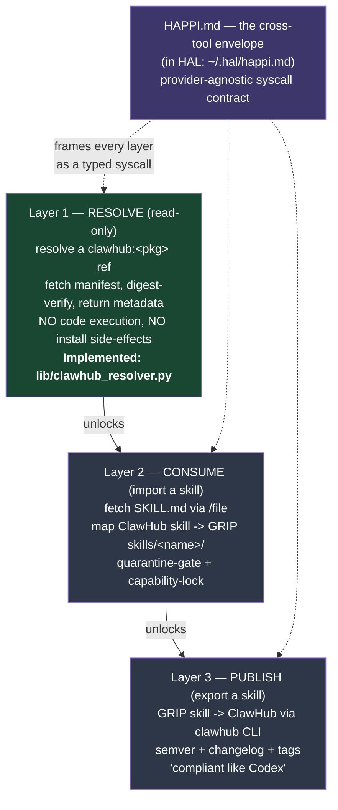
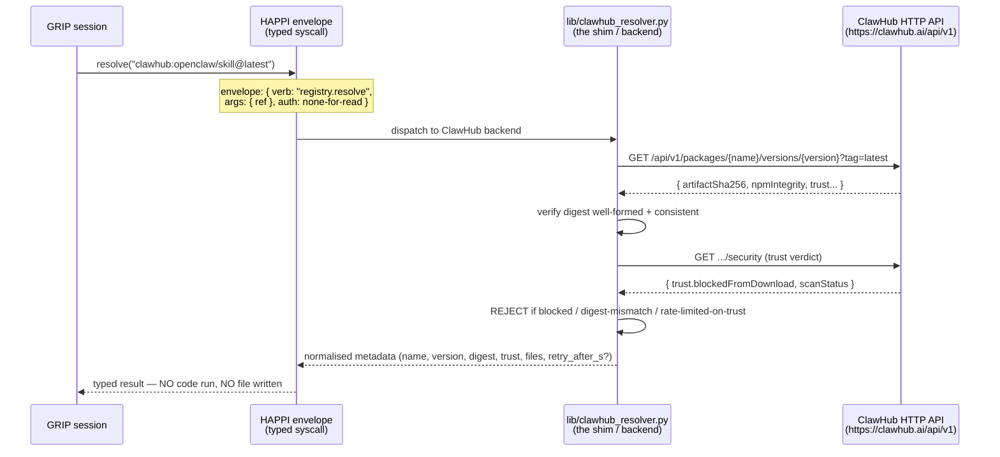

# ClawHub Compatibility — How GRIP/HAL Becomes a First-Class Citizen

> **What this is, in one breath.** ClawHub is OpenClaw's public registry for
> reusable "skills" — versioned text bundles built around a `SKILL.md` file,
> the same shape GRIP already uses for its own skills. This document designs
> how GRIP (and HAL, its provider-abstraction layer) becomes **ClawHub-compatible**:
> able to *consume* skills published to ClawHub and, eventually, *publish*
> GRIP's own skills there — "compliant like Codex," the way Codex is a
> first-class citizen of its ecosystem.

> **Companion document.** `docs/research/openclaw-transport-study.md` analyses
> OpenClaw's WhatsApp transport doctrine (the five composable invariants that
> keep any connection alive). That study establishes the resilience vocabulary
> this design applies to registry calls: the same bounded-retry, fail-safe,
> rate-limit-aware posture that governs socket reconnection governs ClawHub
> HTTP calls.

> **The happy accident at the centre of this design.** GRIP and ClawHub
> independently converged on the **same primitive**: a skill is a `SKILL.md`
> file plus supporting files. GRIP's skills (`skills/<name>/SKILL.md`, YAML
> frontmatter for `name`/`description`/triggers) and ClawHub's skills
> ("versioned text bundles with `SKILL.md` plus supporting files") are the
> same animal. Compatibility is therefore **mostly a transport-and-trust
> problem, not a format-translation problem** — which is why it's tractable.

---

## 1. What ClawHub is (the parts that matter for compatibility)

From the ClawHub docs (`docs.openclaw.ai/clawhub`, `/clawhub/api`,
`/clawhub/http-api`):

- **Registry of skills + plugins.** "The public registry for OpenClaw skills
  and plugins." Anyone can upload (with a sufficiently-aged GitHub account).
- **A skill is a versioned text bundle.** "Versioned text bundles with
  `SKILL.md` plus supporting files." Installed via `openclaw skills install
  <slug>`; published via `clawhub skill publish <path>`.
- **Three package types beyond skills** (out of scope for GRIP consumption,
  noted for completeness): *code plugins* (npm packages with
  `openclaw.compat.pluginApi` metadata in `package.json`), *bundle plugins*,
  and *souls* (`SOUL.md` bundles).
- **Rich version metadata.** "Semver versions, tags such as `latest`,
  changelogs, files, downloads, stars, and security scan summaries."
- **Integrity is first-class.** Every artifact carries a content digest
  (`artifactSha256`, plus npm-style `npmIntegrity`/`npmShasum` for ClawPack
  tarballs); downloads expose the digest in an `X-ClawHub-Artifact-Sha256`
  response header. The client is expected to verify downloaded bytes against
  it.
- **Trust is first-class.** A per-version security endpoint exposes
  `trust.scanStatus`, `trust.blockedFromDownload`, and `trust.reasons` (e.g.
  `"manual:quarantined"`, `"scan:malicious"`) so a consumer can refuse to
  install something the registry has flagged.

**The two ClawHub properties that drive GRIP's design** are the last two:
**every artifact is content-addressed (a digest), and every version carries a
trust verdict.** A GRIP-side consumer that ignores either would be importing
unverified, possibly-quarantined code — exactly the threat GRIP's safety rules
forbid (`rules/untrusted-content-capability-lock.md`,
`rules/no-guardrail-evasion.md`).

### 1.1 SKILL.md frontmatter reference

A ClawHub skill's `SKILL.md` uses YAML frontmatter that maps cleanly onto
GRIP's own `skills/<name>/SKILL.md` convention. The near-identity mapping
claimed in the introduction holds against the following concrete key inventory:

| ClawHub frontmatter key | GRIP frontmatter key | Notes |
|---|---|---|
| `name` | `name` | Identical semantics; ClawHub scopes it as `<owner>/<name>` in the slug |
| `description` | `description` | Plain-English one-liner; identical |
| `triggers` | `triggers` | List of trigger phrases; identical list shape |
| `version` | *(in frontmatter provenance block on import)* | ClawHub semver; GRIP records on import but doesn't expose in its own frontmatter |
| `compatibility` | *(none — GRIP-internal)* | Optional list of compatible OpenClaw/ClawHub API versions |
| `compat_min_version` | *(none — GRIP-internal)* | Minimum host version required; guards cross-version consumption |
| `author` | *(none — GRIP-internal)* | Publisher identity; recorded in import provenance |
| `license` | *(none — GRIP-internal)* | SPDX identifier; noted in import provenance |

**Falsification of the "near-identity" claim.** The mapping is near-identity if
and only if `name`, `description`, and `triggers` cover the semantically
load-bearing fields — i.e., the fields a consuming system must read to activate
a skill correctly. The ClawHub-unique fields (`version`, `compatibility`,
`compat_min_version`, `author`, `license`) are all **provenance / governance**
metadata that GRIP's own skills do not need because GRIP manages them through
its own registry. A Layer 2 importer that reads the three core fields and
stores the provenance fields as-is (in a `_clawhub` frontmatter block) satisfies
the mapping without a format translator. The mapping is *not* near-identity if
ClawHub adds semantic fields that change skill activation behaviour — that would
require a real translator, and is the falsification condition for this design.

---

## 2. The HTTP API contract GRIP consumes

GRIP only needs the **read** surface of the ClawHub HTTP API
(`base = https://clawhub.ai`, prefix `/api/v1/`). The write surface
(publish/upload) is Phase 2 and uses ClawHub's own CLI, not raw HTTP. The
read endpoints that matter:

| Purpose | Endpoint | Key response fields |
|---|---|---|
| Resolve a package | `GET /api/v1/packages/{name}` | owner, moderation state, platform metadata |
| Resolve a skill | `GET /api/v1/skills/{slug}` | owner, moderation state |
| Version metadata | `GET /api/v1/packages/{name}/versions/{version}` | `version.artifactSha256`, `version.npmIntegrity`, `version.artifact.kind` |
| List versions | `GET /api/v1/packages/{name}/versions` | paginated (`limit` 1-100, `cursor`/`nextCursor`) |
| Resolve a tag | any endpoint + `?tag=latest` | resolves the tagged version |
| Fetch a text file | `GET /api/v1/packages/{name}/file?path={path}&version={version}` | raw text, max 200 KB, binary → `415` |
| Download artifact | `GET /api/v1/packages/{name}/download?version={version}` | bytes + `X-ClawHub-Artifact-Sha256` header |
| Trust verdict | `GET /api/v1/packages/{name}/versions/{version}/security` | `trust.scanStatus`, `trust.blockedFromDownload`, `trust.reasons` |
| Auth (publish only) | `Authorization: Bearer clh_...`; `GET /api/v1/whoami` | validates token |
| Rate limits | every response | `RateLimit-Limit`, `RateLimit-Remaining`, `RateLimit-Reset`; `X-RateLimit-*` variants; `Retry-After` on `429` |

**Rate-limit handling is mandatory.** ClawHub issues `429 Too Many Requests`
when the anonymous read rate limit is exceeded. Any GRIP consumer that ignores
`429` responses and retries immediately risks an automatic ban. The contract:

1. On any `429`, read the `Retry-After` header (integer seconds); wait that
   duration before retrying. If absent, apply an exponential backoff with a
   minimum floor of 60 seconds.
2. Treat a `429` on the **trust/security endpoint** as "trust unavailable →
   blocked": fail-safe (conservative) rather than assuming the package is safe
   just because the trust check couldn't run. This is the posture implemented
   in `lib/clawhub_resolver.py::_read_trust`.
3. Treat a `429` on the **version metadata endpoint** as a resolution failure
   with a `retry_after_s` hint surfaced to the caller: do not assume
   "not found", surface the retry hint so the caller can schedule a retry
   rather than marking the ref permanently unresolvable.

**The crucial observation for safety:** the **`/file` endpoint returns raw
text** (a `SKILL.md`, max 200 KB), with **no code-execution path**. A GRIP
consumer that reads a skill's `SKILL.md` via `/file` — rather than downloading
and unpacking the `.tgz` artifact — gets the skill's *content* without ever
fetching or running an executable bundle. This is the read-only consumption
posture GRIP should default to.

---

## 3. The three layers of compatibility

GRIP/HAL compatibility decomposes into three layers, each shipped
independently. **Layer 1 is implemented** (Wave 3 of this sprint — the
resolver and its test suite); Layers 2 and 3 are designed here and deferred.

### Layer 1 — Resolve (read-only) — **implemented**

Take a reference like `clawhub:openclaw/some-skill@1.2.0` (or `@latest`),
call the ClawHub HTTP API to fetch its version metadata, **verify the
declared digest is well-formed and consistent**, and return a normalised
metadata object: name, version, digest, trust verdict, file list. **No bytes
are executed, no files are written, nothing is installed.** This is the
foundation every higher layer builds on, and it is deliberately the *least
dangerous* thing GRIP can do with ClawHub — pure information retrieval.

The resolver is `lib/clawhub_resolver.py`. Its test suite is
`tests/test_clawhub_resolver.py`. Safety contract:

- **Read-only HTTP** (stdlib `urllib`, `GET` only — never `POST`, never a
  download-and-unpack).
- **Digest is mandatory.** A version whose `artifactSha256` is missing or
  malformed is **rejected**, not trusted. When the resolver also fetches an
  artifact's download header, a header/manifest digest mismatch is **rejected**.
- **Trust verdict is surfaced.** If the registry reports
  `trust.blockedFromDownload`, the resolver marks the ref unsafe so no higher
  layer can proceed.
- **Rate-limit aware.** A `429` on the version endpoint returns a `retry_after_s`
  hint; a `429` on the trust endpoint is treated as trust-unavailable → blocked
  (fail-safe). Neither case retries automatically — the caller decides when to
  retry (GRIP's own reconnect-governor discipline applied to registry calls).
- **No code-execution path exists in the module at all** — verified by a test
  asserting the module neither imports `subprocess`/`os.system`/`exec` nor
  writes files.

### Layer 2 — Consume (import a skill) — designed, deferred

Once a ref resolves safely, GRIP can *import* the skill: fetch its `SKILL.md`
(and listed supporting text files) via the read-only `/file` endpoint, then
materialise it as a local `skills/<name>/` directory in GRIP's own format.
Because GRIP and ClawHub share the `SKILL.md` primitive, the mapping is
near-identity (see §1.1 for the concrete field inventory):

| ClawHub skill | GRIP skill |
|---|---|
| `SKILL.md` (text bundle root) | `skills/<name>/SKILL.md` |
| supporting text files | files under `skills/<name>/` |
| `slug` | `name` (frontmatter) |
| `version`, `compat_min_version`, `author`, `license` | recorded in `_clawhub` provenance block in frontmatter |
| `trust.scanStatus` | gate: refuse import if quarantined/malicious |

**Safety gates Layer 2 MUST apply** (this is where GRIP's rules bind hardest):

1. **Quarantine gate.** Refuse to import any version with
   `trust.blockedFromDownload === true` or a `scan:malicious` reason. The
   registry's own verdict is an *exogenous* signal (per
   `rules/exogenous-anchor-law.md`) — GRIP trusts it as one input, never as
   the sole one.
2. **Capability lock.** An imported `SKILL.md` is *untrusted third-party
   content*. Per `rules/untrusted-content-capability-lock.md`, GRIP must NOT
   auto-activate an imported skill with full tool access. Imported skills land
   in a **review-gated quarantine directory** (e.g. `skills/_imported/`),
   inert until a human or an explicit gate promotes them. Importing ≠ trusting.
3. **Digest re-verification.** The `SKILL.md` text fetched via `/file` is
   checked against the manifest's per-file expectation where ClawHub exposes
   one; the artifact digest from Layer 1 anchors the version's identity.
4. **No executable bundle by default.** Layer 2 consumes *text* (`/file`),
   not the `.tgz` artifact. Fetching/unpacking an executable bundle is a
   separate, explicitly-gated decision — never the default consume path.

### Layer 3 — Publish (export a skill) — designed, deferred

The "compliant like Codex" goal: GRIP publishes its own skills *to* ClawHub so
the wider OpenClaw ecosystem can consume them. This uses ClawHub's own
`clawhub skill publish <path>` CLI with `--version`, `--changelog`, `--tags`,
authenticated via a `Bearer clh_...` token (kept in the macOS keychain, read
through GRIP's secret shim — never inlined, per `rules/syscall-doctrine.md`).

**What "compliant like Codex" means concretely:** Codex is a first-class
ClawHub citizen because it (a) presents skills in the registry's expected
shape, (b) carries correct compatibility metadata, and (c) passes the
registry's security scan. GRIP achieves the same by:

- Publishing each `skills/<name>/SKILL.md` as a ClawHub skill bundle (the
  formats already align per §1.1 — minimal transform).
- Attaching a changelog and semver derived from GRIP's own versioning.
- Letting ClawHub's security scanner gate the publish — GRIP does not
  self-certify (this is the same *exogenous-anchor* discipline as Layer 2,
  applied to the publish direction).

Publishing is **operator-gated** (a human decides which GRIP skills go public;
some are internal/sensitive) and is therefore explicitly *not* an autonomous
action.

---

## 4. HAPPI.md — framing every layer as one typed syscall

GRIP/HAL's cross-tool contract is **HAPPI** (the Harness-Abstraction Provider
Protocol, defined in HAL at `~/.hal/happi.md`). HAPPI's thesis is that every
external capability — an LLM call, a voice synth, a tool invocation — is a
**typed envelope** dispatched through one provider-agnostic boundary, the way
a Unix program reaches any device through `read()`/`write()`.

ClawHub compatibility slots into HAPPI cleanly because **a registry is just
another external boundary**:

**Why route through HAPPI rather than calling ClawHub directly?** The same
three reasons the syscall doctrine gives for every boundary:

1. **One stable API.** If ClawHub changes its URL scheme or a future registry
   (a hypothetical GRIPHub) appears, only the backend changes — every caller
   keeps the same `registry.resolve` verb.
2. **Trivially mockable.** Tests inject a fake HTTP layer (the resolver's test
   suite does exactly this — DIP, no network in tests).
3. **Audit-ready.** Every registry resolve is one logged envelope: which ref,
   which digest, which trust verdict, allowed-or-rejected. The registry
   boundary becomes an audit boundary, matching how GRIP already treats Slack,
   the keychain, and LLM providers.

HAPPI also makes the **"compliant like Codex" symmetry** explicit: Codex and
GRIP are both *providers* behind the same envelope shape. A registry verb
(`registry.resolve`, later `registry.publish`) is provider-agnostic by
construction — the same reason HAL can swap Anthropic for Gemini behind one
`infer` verb lets GRIP swap ClawHub for any future skill registry behind one
`registry.*` verb.

### 4.1 Transport-doctrine note

The five transport invariants documented in `docs/research/openclaw-transport-study.md`
apply to registry calls with direct mappings:

| Transport invariant | Registry equivalent |
|---|---|
| Bounded reconnect budgets, separated by error class | `retry_after_s` scoped to 429 only; 404 ≠ 429 — different errors, different handling |
| Cache persistence across socket replacement | Resolved metadata cached by caller; resolver is stateless and idempotent |
| Transport-level liveness, not app-level | Trust endpoint `429` → blocked (fail-safe), not "maybe safe" |
| Periodic drain, not reconnect-triggered drain | Registry calls are on-demand; no persistent queue needed |
| Two-phase reconnect routing | Version-endpoint 429 vs trust-endpoint 429 are handled independently (different retry semantics) |

---

## 5. Threat model (why read-only-first is the right sequencing)

| Threat | Mitigation | Layer |
|---|---|---|
| Importing malicious skill code | Read-only resolve first; trust-verdict gate; capability-lock on consume; quarantine dir | 1, 2 |
| Tampered artifact (bytes ≠ declared) | Mandatory digest verification; reject on mismatch | 1 |
| Registry-flagged package slips through | `trust.blockedFromDownload` checked before any consume | 1, 2 |
| Auto-activation of untrusted content | Imported skills land inert in `skills/_imported/`; promotion is gated | 2 |
| Token leak on publish | Keychain via secret shim; never inlined; `Bearer` only at publish | 3 |
| Registry outage breaks GRIP | Resolver fails *safe* (returns an unresolved/unsafe verdict), never crashes the session | 1 |
| Rate-limit auto-ban | `429` surfaces `retry_after_s`; trust `429` → blocked (fail-safe); no auto-retry | 1 |
| Frontmatter injection via imported SKILL.md | Imported skills land in quarantine dir; capability-lock gates activation | 2 |

**The sequencing is the safety argument.** Layer 1 (resolve) can do nothing
dangerous — it reads metadata and verifies a digest. Shipping it first lets
GRIP interact with ClawHub immediately at zero risk, and proves the transport
and trust plumbing before any byte is ever consumed or executed. Layers 2 and
3 add capability only behind explicit gates. This is the same
*least-privilege, escalate-only-behind-a-gate* posture as GRIP's untrusted-content
capability lock.

---

## 6. What ships when

| Layer | Deliverable | Status |
|---|---|---|
| 1 — Resolve | `lib/clawhub_resolver.py` + `tests/test_clawhub_resolver.py` | **Implemented** |
| 2 — Consume | Skill-import pipeline + quarantine dir + capability lock | Designed here; deferred (needs the resolver first) |
| 3 — Publish | `clawhub` CLI integration + operator gate | Designed here; deferred (operator-gated, non-autonomous) |

**Falsification of this design.** This compatibility model is wrong if: (a)
ClawHub's `SKILL.md` semantics turn out to diverge materially from GRIP's
(making the near-identity mapping in §1.1 false — if ClawHub adds semantic
activation fields beyond `name`/`description`/`triggers`, a real translator
is needed); or (b) the read-only `/file` endpoint proves insufficient to
reconstruct a usable skill (forcing artifact download into the default path,
raising the threat surface); or (c) ClawHub's trust verdict proves unreliable
as an exogenous signal (then GRIP must add its own scan, not lean on the
registry's). Each is checked at the boundary before the corresponding layer
ships.

---

## 7. Provenance and licence note

- **Sources:** ClawHub docs at `docs.openclaw.ai/clawhub`, `/clawhub/api`,
  `/clawhub/http-api` (read via WebFetch during initial draft; 403-gated on
  subsequent access — content reflected in this document was read during the
  original session). Endpoint paths, field names, and header names are quoted
  from those pages.
- **Licence discipline.** OpenClaw/ClawHub is `NOASSERTION`. This document
  describes the *public HTTP contract* (URLs, field names, headers — facts of
  interoperability, not copyrightable expression) and designs GRIP's *own*
  compatibility layer in GRIP's architecture and vocabulary. No OpenClaw source
  code is reproduced. The resolver (`lib/clawhub_resolver.py`) is independently
  implemented in GRIP's style against the public API.
