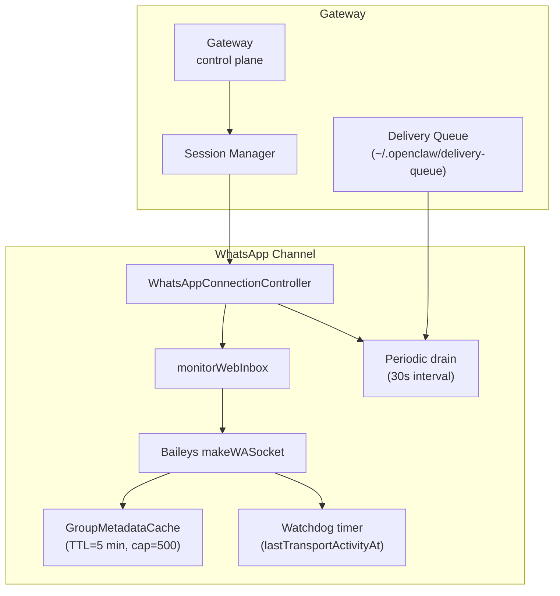
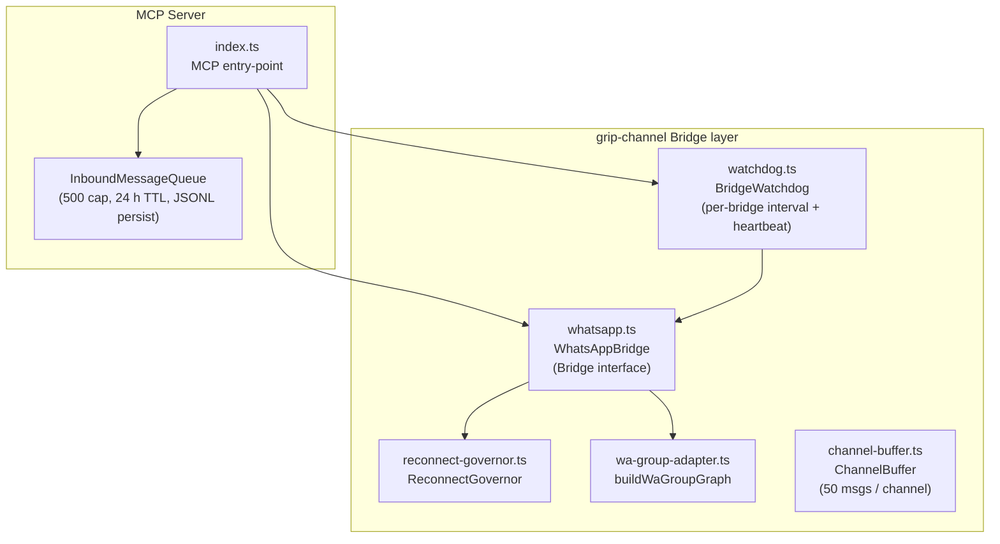
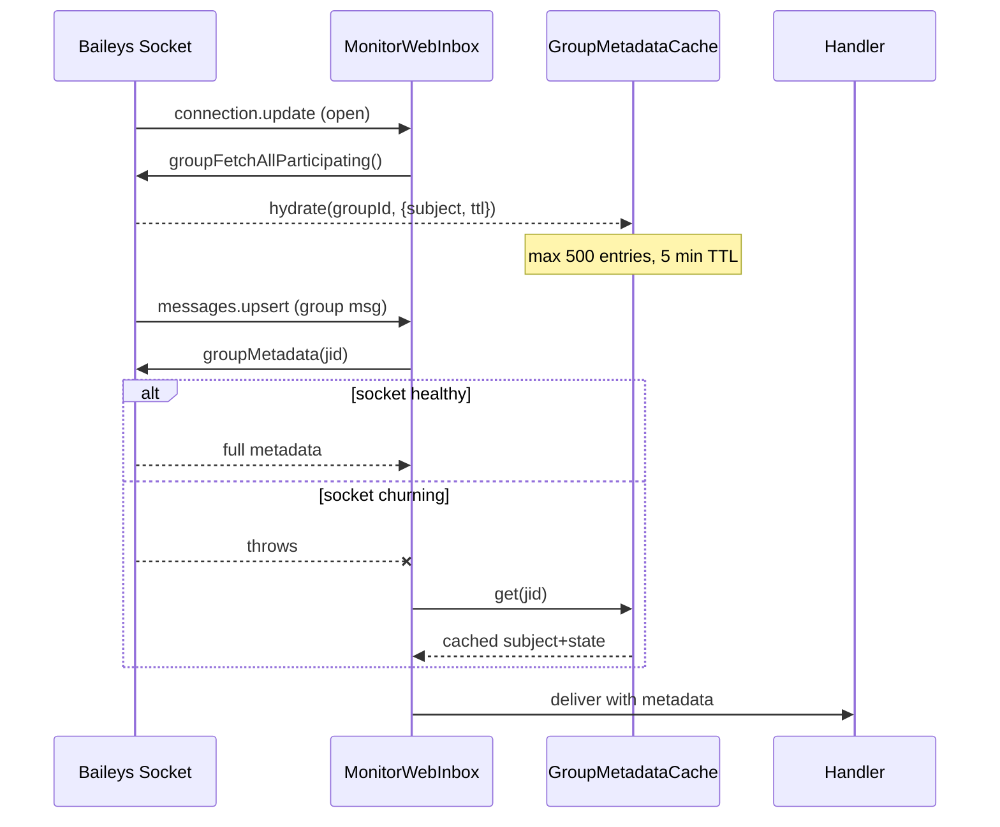
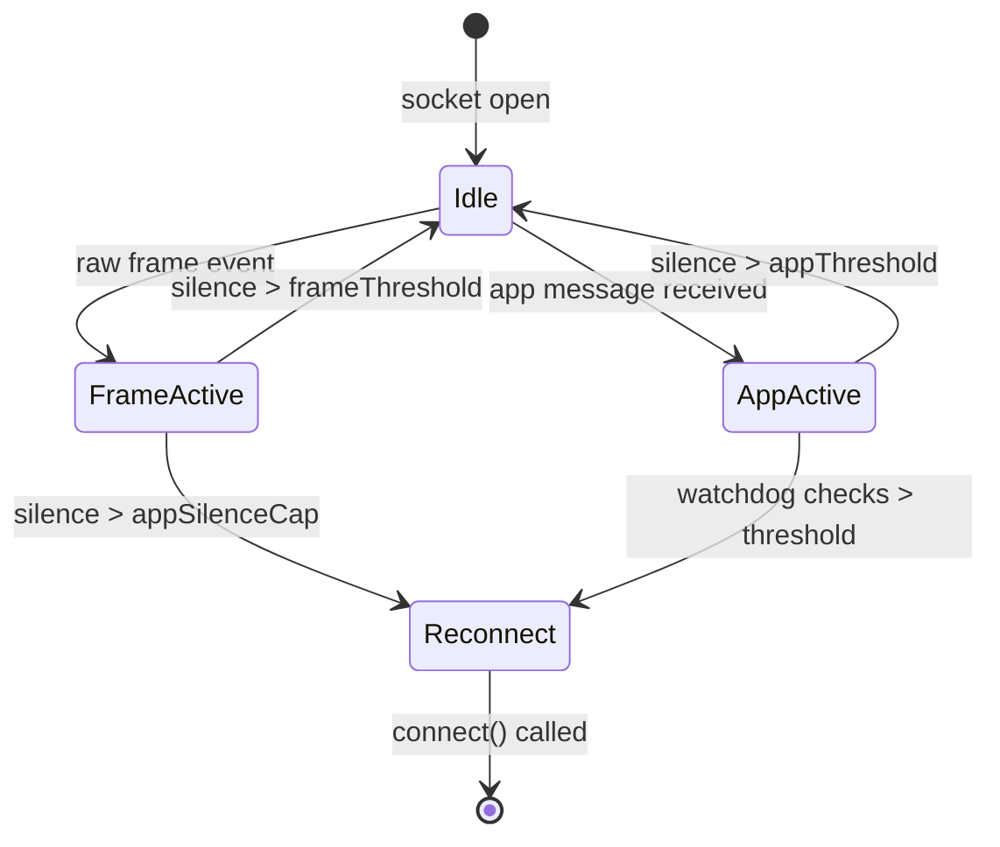

# OpenClaw WhatsApp Transport Study

> Syscall-doctrine analysis of how OpenClaw keeps ANY transport connected:
> stable API surface + resilient hot-swappable backend.
> Informed by merged PRs from the OpenClaw OSS codebase (NOASSERTION licence).
> Patterns are documented for GRIP re-implementation; no source was copied verbatim.

---

## 1. Executive Summary

OpenClaw's transport reliability story is not a single architectural decision but
an accumulating set of composable invariants, each patching a distinct failure
mode discovered in production. Reading the merged PR history reveals a **doctrine
of bounded, observable, transport-agnostic reconnect loops** layered on top of
Baileys' raw WebSocket lifecycle.

Five canonical PRs are analysed in detail in §5. §6 confirms with six additional
PRs that the same invariants apply to every other transport (Telegram, Mattermost,
WebChat), making the patterns generalise well beyond WhatsApp.

Of the five invariants, GRIP already implements two: watchdog reset on reconnect
(`BridgeWatchdog`) and inbound-message persistence (`InboundMessageQueue`).
Three are absent — transport-level liveness, cross-reconnect group metadata cache,
and periodic outbound drain. The §7 gap table maps each invariant precisely against
GRIP's current state and points to concrete, file-safe additions.

---

## 2. Codebases Under Analysis

| Project | Role | Baileys? | Transport layer |
|---------|------|----------|-----------------|
| OpenClaw | Personal AI assistant (375 k★ OSS) | Yes (WA) | `src/` gateway + `packages/` channel adapters |
| GRIP | Org AI agent (MCP-server architecture) | Yes (WA) | `mcp-servers/grip-channel/src/` Bridge interface |

### Lineage note

OpenClaw's WhatsApp stack descends from the same Baileys integration that
informed GRIP's original `whatsapp.ts` (via the ex-CIPS/ClawdBot lineage).
The two codebases have diverged substantially; OpenClaw's 375 k-star adoption
means its failure modes and fixes are battle-tested at far greater scale.

---

## 3. OpenClaw Transport Architecture



**Key invariant**: the `WhatsAppConnectionController` owns the Baileys socket
lifecycle. `monitorWebInbox` is the inbound-message observer. Both are wired
through an explicit cache reference so reconnection events do not lose group
metadata.

---

## 4. GRIP Transport Architecture



**Key difference**: GRIP uses a `Bridge` interface (`connect/disconnect/sendText/
heartbeat`) backed by one concrete implementation per platform. OpenClaw uses
a gateway+adapter pattern where the controller and monitor are separate objects
that share mutable state (socket ref, cache) via closure.

---

## 5. Canonical PR Analysis

### PR #88183 — Retry QR login on 408 timeout

**Problem**: Baileys reports HTTP 408 (timeout) before a QR code can be
displayed. The single-attempt error propagated as a fatal exit, forcing users to
manually restart.

**Pattern**:
1. **Separate retry budgets** — the 408 counter is independent of the 515
   (post-pairing restart) counter. One failure mode never exhausts the other's
   recovery capacity.
2. **QR flow reactivation** — after a replacement socket is created the code
   explicitly signals the QR-generation path so a fresh code is emitted.
3. **Bounded by construction** — the budget is a small integer (tested at 1
   retry); exhaustion produces a relink prompt rather than a silent loop.

**GRIP status**: `ReconnectGovernor` (off-limits PR) addresses related reconnect
bounding. The specific QR / pre-auth path is not yet separated from the
post-connection budget.

---

### PR #73732 — Recover group inbound after reconnect churn

**Problem**: After repeated 408 reconnect cycles WhatsApp group messages drop
silently while DMs survive. Root cause: Baileys' `groupMetadata(jid)` call fails
during reconnect churn because the group-participant index lives inside the
socket, which is replaced on each reconnect.

**Pattern**:
1. **Bounded group metadata cache** — stores only (subject, TTL-state) tuples,
   NOT full participant lists. Bounded at 500 entries + 5-minute TTL.
2. **Hydration on connect** — `groupFetchAllParticipating()` populates the cache
   once per successful connection, not on every inbound message.
3. **Graceful fallback** — when the live socket call fails, the stale cache entry
   is returned instead of crashing the message pipeline.
4. **Wired through all socket layers** — the cache reference threads from the
   controller through every observer to avoid a second-source-of-truth problem.



**GRIP status**: `wa-group-adapter.ts` builds a `GuildConversationGraph` from
group messages but does NOT maintain a cross-reconnect metadata cache. Group
metadata is re-derived from message content on each call rather than seeded
from Baileys' `groupFetchAllParticipating()` output.

---

### PR #72145 — Stop reconnecting quiet sockets

**Problem**: The watchdog timer's activity baseline was inbound application
messages. A 30-minute idle session (legitimately quiet) triggered a reconnect
loop because no app messages arrived, even though the WebSocket transport was
healthy.

**Pattern**: shift from **app-level** to **transport-level** liveness.
1. Introduce `lastTransportActivityAt` — updates on BOTH app messages AND raw
   `"frame"` events from `sock.ws`.
2. Apply a **application-silence cap** — if no app message has arrived in
   `appSilenceCap` (e.g., 8 hours), the transport-activity baseline no longer
   suppresses reconnect. This prevents dead sockets from hiding behind protocol
   keepalive frames indefinitely.
3. **Throttle the frame listener** — updates are rate-limited so a frame storm
   does not create unbounded write pressure on `lastTransportActivityAt`.
4. **Listener deregistration** — wired into `closeCurrentConnection` AND error
   paths to prevent memory leaks.

Note: these properties are independent of the watchdog's reconnect-counter reset
behaviour (§7 "Watchdog reset on reconnect"). The frame-event baseline is about
*what signal drives the liveness decision*; the counter reset is about *what
state is cleared after a successful reconnect*. GRIP already has the latter;
it lacks the former.



**GRIP status**: `BridgeWatchdog` uses the `Bridge.heartbeat()` return value
as its activity baseline. This is app-level (it sends a probe and checks delivery).
The watchdog does NOT observe raw Baileys frame events — it cannot distinguish a
healthy quiet socket from a zombie that only exchanges keepalive frames.

Separately: `BridgeWatchdog` already resets `disconnectedChecks = 0` after a
successful `connect()` call (the counter reset invariant — see §7 row 6).

---

### PR #79083 — Periodic delivery-queue drain

**Problem**: `drainPendingDeliveries` was only called on reconnect. Outbound
messages enqueued while the channel was already connected sat in the delivery
queue for up to 26 minutes in production.

**Pattern**:
1. **30-second periodic drain** inside the connect block (a `setInterval`).
2. **Cleared on close** — interval cleared on both `connection.close` and
   keep-alive disconnect to prevent ghost drains after the socket has gone.
3. **Predicate-filtered** — drain selects only entries for this
   `(channel, accountId)` pair, reusing the same `selectEntry` predicate as
   the reconnect drain, so the drain logic is not duplicated.
4. **Backoff preserved** — `bypassBackoff: false` so retry semantics and
   duplicate-send guards remain intact.

**GRIP status**: `InboundMessageQueue` handles inbound buffering with JSONL
persistence. There is no outbound delivery queue with a periodic drain; GRIP
relies on in-process send primitives (`Bridge.sendText`). An outbound
persistence + periodic drain would benefit async multi-session scenarios.

---

### PR #50091 — Proxy version-refresh (superseded)

**Problem**: In proxy-constrained environments (e.g. OpenShell) Baileys could
not refresh the WhatsApp Web client version through the network path, causing
login failures.

**Pattern** (of the eventual merged implementation, not this PR):
1. **Ambient proxy dispatcher** — the gateway/CLI bootstrap installs an Undici
   env-proxy dispatcher so ALL network calls (including Baileys' internal
   `fetch`) inherit proxy configuration without per-call wiring.
2. **Explicit agent pass-through** — `makeWASocket` receives both
   `HttpsProxyAgent` (WebSocket path) and `ProxyAgent` (fetch/media path).
3. **Fallback version harvest** — when Baileys reports a non-latest version,
   `sw.js` is fetched through the proxy to extract `client_revision` rather
   than hard-coding a version.

**GRIP status**: Not applicable at the GRIP repo boundary (grip-channel runs
inside a container; proxy threading is handled at the Docker/network layer).
However, the version-refresh fallback pattern is worth noting if GRIP ever
operates in restricted-egress environments.

---

## 6. Additional Transport PRs — Cross-Channel Pattern Confirmation

| PR | Transport | Pattern confirmed |
|----|-----------|-------------------|
| #75773 | WhatsApp | Opening-phase 428 routed through `consumeReconnectAttempt()` — two-phase reconnect routing (pre-open vs post-open) |
| #83304 | Telegram | Lower polling keepalive delay — transport keepalive interval tuning |
| #73979 | Mattermost | WebSocket ping/pong keepalive — explicit heartbeat at transport layer |
| #82227 | Telegram | Drain outbound queue after polling reconnect — same drain-on-reconnect pattern as #79083 |
| #74224 | TUI | Resync streaming watchdog after reconnect — watchdog must reset its baseline after reconnect, not carry stale counters |
| #87531 | WebChat | Preserve sends through reconnect — in-flight sends must survive reconnect rather than being silently dropped |

**Cross-channel invariant**: every transport in OpenClaw that experiences
reconnect churn eventually acquires (a) a watchdog reset after reconnect, and
(b) a drain or replay mechanism for messages enqueued during the outage window.

---

## 7. Gap Analysis: GRIP vs OpenClaw Doctrine

| Doctrine | OpenClaw | GRIP | Gap / Action |
|----------|----------|------|--------------|
| **Transport-level liveness** | `lastTransportActivityAt` tracks raw Baileys frames | `BridgeWatchdog.heartbeat()` sends an app-level probe | GRIP watchdog is blind to healthy quiet sockets. Add `wa-transport-activity-tracker.ts` (new file, Baileys frame observer, throttled) |
| **Cross-reconnect group metadata** | Bounded cache (500 entries, 5 min TTL), hydrated from `groupFetchAllParticipating()` | `wa-group-adapter.ts` re-derives metadata from message content per call | Add `wa-group-meta-cache.ts` (new file, BoundedMap-backed, hydration hook) |
| **Separate retry budgets** | 408 counter independent of 515 counter | `ReconnectGovernor` (off-limits branch) | Handled by concurrent PR; GRIP doctrine: never collapse distinct error-class budgets into one counter |
| **QR flow reactivation** | Replacement socket re-signals QR generation | Within `whatsapp.ts` (off-limits) | Tracked; no new file needed |
| **Periodic outbound drain** | 30 s interval, cleared on close | In-process `Bridge.sendText` only | Low priority for current GRIP use-case; action if async delivery queue is added |
| **Watchdog reset on reconnect** | `disconnectedChecks` and failure counters reset after successful `connect()` | `BridgeWatchdog` already resets `disconnectedChecks = 0` on successful reconnect | Already correct |
| **Application-silence cap** | Caps the frame-only suppression of reconnect | Not yet applicable (GRIP watchdog is app-level) | Prerequisite: transport-level tracker above |
| **Proxy ambient dispatcher** | Bootstrap installs Undici env-proxy | Container-boundary handled externally | No action needed at repo level |

---

## 8. Recommended New Files (Wave 1 → Future Waves)

All safe to add without touching `whatsapp.ts` or `reconnect-governor.ts`:

```
mcp-servers/grip-channel/src/
  wa-transport-activity-tracker.ts   # throttled Baileys frame observer
  wa-group-meta-cache.ts             # bounded cross-reconnect group cache
```

See also: `lib/clawhub_resolver.py` and `docs/research/clawhub-compat-design.md`.

---

## 9. Architectural Comparison Diagram

```mermaid
flowchart LR
    subgraph OpenClaw_WA["OpenClaw WhatsApp"]
        direction TB
        OC_CTRL[ConnectionController]
        OC_MON[monitorWebInbox]
        OC_CACHE[GroupMetadataCache]
        OC_WD[Watchdog\nlastTransportActivityAt]
        OC_DQ[DeliveryQueue\n30s drain]
        OC_SOCK[Baileys Socket]

        OC_CTRL --> OC_MON
        OC_CTRL --> OC_WD
        OC_CTRL --> OC_DQ
        OC_MON --> OC_CACHE
        OC_MON --> OC_SOCK
        OC_WD --> OC_SOCK
    end

    subgraph GRIP_WA["GRIP WhatsApp"]
        direction TB
        G_BRIDGE[WhatsAppBridge]
        G_RG[ReconnectGovernor\n(off-limits)]
        G_WD[BridgeWatchdog\nheartbeat-level]
        G_WGA[WaGroupAdapter\nper-message]
        G_IQ[InboundMessageQueue\nJSONL persist]
        G_CB[ChannelBuffer\n50 msgs]
        G_SOCK[Baileys Socket]

        G_BRIDGE --> G_RG
        G_BRIDGE --> G_WGA
        G_BRIDGE --> G_SOCK
        G_WD --> G_BRIDGE
        G_IQ --> G_BRIDGE
    end

    OC_CACHE -.->|"gap: cross-reconnect\ngroup cache"| G_WGA
    OC_WD -.->|"gap: frame-level\nactivity tracking"| G_WD
    OC_DQ -.->|"gap: periodic\noutbound drain"| G_IQ
```

---

## 10. Conclusion

OpenClaw's transport resilience rests on five composable invariants, each
derived from one of §5's canonical PR analyses:

1. **Bounded reconnect budgets, separated by error class** (from #88183) —
   exhaustion of one class does not consume another's capacity.
2. **Cache persistence across socket replacement** (from #73732) — group
   metadata, message state, and activity timestamps survive reconnection by
   living outside the socket object.
3. **Transport-level liveness, not app-level** (from #72145) — watchdog
   baseline tracks raw protocol frames, not application messages, preventing
   false reconnect storms on quiet-but-healthy sockets.
4. **Periodic drain, not reconnect-triggered drain** (from #79083) — outbound
   delivery is independent of connection events; a live socket should drain its
   queue on a heartbeat.
5. **Two-phase reconnect routing** (from #75773) — errors before socket open
   are routed separately from errors after open, using the same retry
   infrastructure but independent budgets.

§6's six additional PRs confirm these five invariants generalise to every other
OpenClaw transport (Telegram, Mattermost, WebChat, TUI).

GRIP implements invariants 1 (partial, via `ReconnectGovernor`) and 4-partial
(via `InboundMessageQueue`). The highest-value additions are (a) transport-level
liveness tracking (`wa-transport-activity-tracker.ts`) and (b) a cross-reconnect
group metadata cache (`wa-group-meta-cache.ts`), both in new files that do not
touch the off-limits transport pair.
