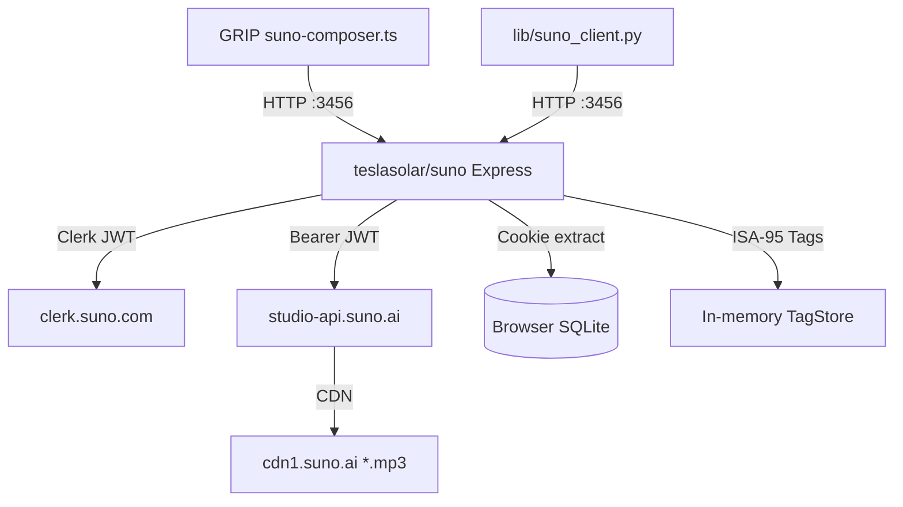
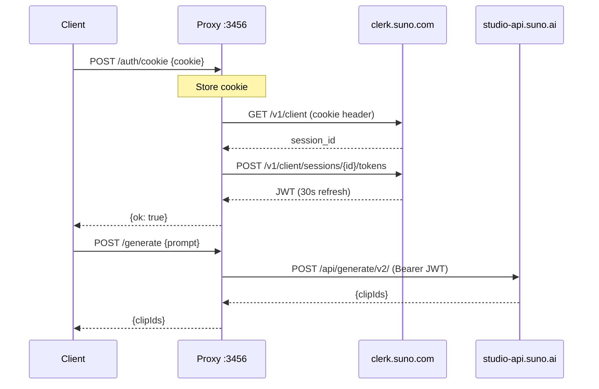

# Suno API Reference — teslasolar/suno (Konomi)

Reverse-engineered API documentation for the Guild's Suno music generation proxy.

## Architecture

## Authentication Flow

## Endpoints

### System (No Auth)

| Method | Path | Response |
|--------|------|----------|
| GET | `/health` | `{ok, version, authenticated, credits, uptime}` |
| GET | `/status` | Full ISA-95 state (equipment, alarms, metrics) |

### Authentication (No Auth)

| Method | Path | Body | Response |
|--------|------|------|----------|
| POST | `/auth/cookie` | `{"cookie":"..."}` | `{ok}` |
| GET | `/auth/status` | -- | Auth state + session info |
| POST | `/auth/extract` | `{"browser":"chrome"}` | Auto-extract from browser DB |

### Generation (Auth Required)

| Method | Path | Body/Params | Response |
|--------|------|-------------|----------|
| POST | `/generate` | `{prompt, style?, title?, instrumental?}` | `{clipIds}` |
| GET | `/poll?ids=a,b` | -- | `[{id, status, audio_url, ...}]` |
| POST | `/lyrics` | `{"prompt":"..."}` | `{id}` |
| GET | `/lyrics/:id` | -- | `{text, status}` |
| GET | `/credits` | -- | `{credits}` |

### Library (Auth Required)

| Method | Path | Response |
|--------|------|----------|
| GET | `/library?page=N` | `[{id, title, status, audio_url, ...}]` |
| GET | `/clip/:id` | `{id, status, title, audio_url, duration, ...}` |

### ISA-95 Tags (No Auth)

| Method | Path | Response |
|--------|------|----------|
| GET | `/tags?prefix=...` | Tag keys |
| GET | `/tags/{path}` | Single tag value |
| PUT | `/tags/{path}` | Write tag: `{"value":...}` |
| GET | `/dump` | Full tag store |

## Clip Lifecycle

`submitted` -> `queued` -> `streaming` -> `complete`

When complete: `audio_url` = `https://cdn1.suno.ai/{id}.mp3`

## Upstream Mapping

| Local | Suno Studio API |
|-------|----------------|
| POST /generate | POST /api/generate/v2/ |
| GET /library | GET /api/feed/ |
| GET /poll | GET /api/feed/?ids= |
| GET /clip/:id | GET /api/clip/:id |
| POST /lyrics | POST /api/generate/lyrics/ |
| GET /credits | GET /api/billing/info/ |

## GRIP Integration

- **TypeScript**: `mcp-servers/grip-channel/src/suno-composer.ts` (SUNO_API_URL env var)
- **Python**: `lib/suno_client.py` (SunoClient class, ISP decomposed)
- **Cost**: 10 credits per generation, 2 clips per request
- **Model**: chirp-v4 (hardcoded in proxy)
