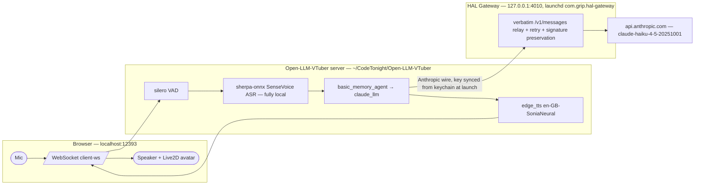

# Voice AI on the HAL Gateway — Quickstart

A hands-free chief-of-staff voice assistant: speak into your mic, a Live2D
avatar answers out loud, and every LLM call routes through the local HAL
Gateway. Built overnight 2026-06-10/11 from
[Open-LLM-VTuber](https://github.com/Open-LLM-VTuber/Open-LLM-VTuber)
(installed at `~/CodeTonight/Open-LLM-VTuber`, outside all GRIP repos).

## Morning quickstart (one command)

```bash
voice-ai
```

That is it. The launcher checks the HAL Gateway, syncs the API key from the
keychain, starts the server if it is not already running, and opens the
browser at `http://localhost:12393`. Then:

1. Click the microphone button in the web UI.
2. Grant microphone permission (first time only).
3. Speak. The avatar listens (local speech recognition), thinks (Claude via
   the HAL Gateway), and answers aloud (text-to-speech).

Other commands: `voice-ai status` (inspect, change nothing) ·
`voice-ai stop` (stop the voice server; never touches the gateway).

## What is running where

| Piece | What | Where |
|-------|------|-------|
| Voice server + web UI | Open-LLM-VTuber v1.2.1 (`uv run run_server.py`) | `localhost:12393`, app at `~/CodeTonight/Open-LLM-VTuber` |
| Speech-to-text | sherpa-onnx SenseVoiceSmall — fully local, no API key; model auto-downloaded to `models/` | inside the voice server |
| LLM | `claude-haiku-4-5-20251001` (fast, voice-latency tier) | via HAL Gateway |
| HAL Gateway | verbatim Anthropic-wire reverse proxy, `~/.hal/lib/hal/gateway.py` | `127.0.0.1:4010`, launchd `com.grip.hal-gateway` |
| Text-to-speech | edge_tts, voice `en-GB-SoniaNeural` (British English), free, no key | inside the voice server |
| Avatar | Live2D `mao_pro` (ships with the repo) | browser |

Proven end-to-end on 2026-06-11 02:13 UTC by
`scripts/voice-ai-e2e-probe.py`: a scripted text turn produced the reply
"I hear you loud and clear through the gateway", one synthesised audio
payload, and an ESTABLISHED TCP connection from the voice server to
`127.0.0.1:4010` during the LLM call — the traffic genuinely traverses the
gateway. Re-run the proof any time:

```bash
~/CodeTonight/Open-LLM-VTuber/.venv/bin/python ~/.claude/scripts/voice-ai-e2e-probe.py
```

## Topology



## Key custody (how the API key is handled)

The Anthropic key lives in the macOS keychain entry
`grip-anthropic-external`. At every launch, `bin/voice-ai` pipes it from the
keychain straight into `lib/voice_ai_keysync.py` over **stdin** (never argv,
never a named environment variable), which rewrites the `claude_llm`
`llm_api_key` line in `conf.yaml` and chmods the file (and its boot-time
`.backup` copy) to 600. The key never appears in any repo, log, or process
list; rotation in the keychain propagates on the next launch.

## Changing things

All app config is `~/CodeTonight/Open-LLM-VTuber/conf.yaml`:

- **Model**: `llm_configs.claude_llm.model` — e.g. `claude-sonnet-4-6` for a
  smarter (slower) assistant.
- **Voice**: `tts_config.edge_tts.voice` — list options with
  `uv run edge-tts --list-voices`. Fallback `en-US-AvaMultilingualNeural`.
- **Persona**: `character_config.persona_prompt` — currently a concise
  British-English chief-of-staff named GRIP.
- **Tool use**: `use_mcpp: False` tonight (reliability first). Re-enable with
  a supervised test if you want the assistant calling MCP tools mid-voice.
- **OpenAI-wire fallback** (if the Anthropic path ever misbehaves): set
  `llm_provider: 'openai_compatible_llm'` and under
  `llm_configs.openai_compatible_llm` set `base_url:
  'http://127.0.0.1:4010/v1'` — the gateway also carries
  `/v1/chat/completions`.

## Troubleshooting

| Symptom | Fix |
|---------|-----|
| "HAL gateway unreachable" from launcher | `launchctl kickstart -k gui/$(id -u)/com.grip.hal-gateway`, or from `~/.hal`: `python3 -m lib.hal.gateway` |
| Browser tab opens but avatar never loads | Hard-refresh; check server log in the `voice-ai` terminal |
| Mic button does nothing | Browser mic permission: Settings → Privacy → Microphone |
| Replies are text but no sound | edge_tts needs network; check connectivity, or switch TTS voice |
| Port 12393 busy | `voice-ai stop` then `voice-ai` (something held the old server) |

## Security posture (accepted trade-offs, stated plainly)

- Reply TEXT goes to Microsoft's edge_tts cloud service for synthesis. Your
  spoken AUDIO never leaves the machine (SenseVoice runs locally). The real
  fix is a GRIP-native TTS adapter (grip-speak/Gemini via HAL) — tracked as a
  follow-up.
- `conf.yaml` holds the key at rest, chmod 600, outside all git repos, on a
  FileVault disk — same posture as `~/.claude/.credentials.json`.
- The web UI binds `localhost` only (`system_config.host`). Do not change to
  `0.0.0.0` without adding auth in front.

## Follow-ups (filed, not blocking)

1. GRIP-native TTS adapter implementing their `TTSInterface` against
   `bin/grip-speak` (Gemini TTS via HAL council) — keeps reply text on-device
   pipeline-controlled.
2. Re-enable MCP tools (`use_mcpp: True`) after a supervised voice-turn test.
3. Desktop pet mode + global hotkey (their Electron client) if the browser
   tab workflow feels heavy.
