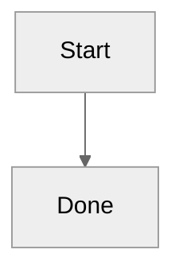

# System Diagramming

A diagram answers one question for one reader. This skill picks the notation, then takes a Mermaid diagram from source to a checked picture.

## When to Use

- Documenting system architecture or communicating a design
- Creating, checking or repairing any Mermaid diagram
- Architect-mode sessions

## Choose the Notation

| Question | Notation | Mermaid header |
|----------|----------|----------------|
| What does the system touch, and what runs inside it? | C4 | `C4Context`, `C4Container`, `C4Component` |
| Who calls whom, in what order? | Sequence | `sequenceDiagram` |
| How is the data shaped? | Entity-relationship | `erDiagram` |
| Which path does a decision take? | Flowchart | `flowchart TD` |
| Which states can it reach? | State machine | `stateDiagram-v2` |
| How do the types relate? | Class | `classDiagram` |
| How are the services laid out? | Architecture | `architecture-beta` |
| What happens when? | Schedule or history | `gantt`, `timeline` |
| How do quantities compare? | Chart | `pie`, `xychart-beta`, `sankey-beta` |

Start at the C4 level the audience needs: Context for everyone, Container for technical leads, Component for developers. For a diagram Mermaid cannot draw, use PlantUML, draw.io or Excalidraw.

## The Mermaid Workflow

Take these nine steps for every Mermaid diagram that reaches a document, report or PR.

1. **Say the question.** Write the question and the reader. Pick the type from the table above.

2. **Keep the source.** Save `d.mmd` beside the picture. Add nothing to a document until the gate passes.

3. **Generate from data where you can.** Prefix every id and quote every label (see "Ids from Data").

4. **Run the gate.** Check the file as well as the exit code (see "The Gate").

5. **Repair from the message.** Try at most 3 times (see "Repair Messages"). Then fail plainly and show the error.

6. **Look at the picture.** Render a PNG from the cleared source with `mmdc -q -i d.mmd -o d.png -s 2`. Read the PNG. The gate cannot judge meaning: a garbage `timeline` passes and draws almost nothing. Keep to about 15 nodes. Split a larger diagram.

7. **Sweep for leaks.** Before a public or external surface, run the shield below from the GRIP tree. It exits 2 and names each finding. Use fakes such as `example.com` for set-dressing (`rules/visual-artifact-leak-prevention.md`).

   ```bash
   bin/grip-py lib/redaction_shield.py verify --profile public /path/to/d.mmd
   ```

8. **Name what it models.** Put `%% models: lib/example.py` in the source, so a reviewer can compare the two. Update the diagram when that code changes. No GRIP check enforces this.

9. **Name the layout, theme and look, and add a title.** Use the source template below.

## Ids from Data

Never use a bare word from the data as an id. When `lib/pr_mermaid_adapter.py` wrote 13 import names as bare ids, these 9 broke the diagram: `click`, `end`, `style`, `class`, `graph`, `subgraph`, `linkStyle`, `classDef` and `flowchart`. That adapter now writes `ref_click["click"]` (GRIP#8956). Prefix the id with any prefix, such as `n_` below, and put the real name in a quoted label. Mermaid reads every `#name;` in a label as an entity. So write a literal `#` as `#35;` first, then a double quote as `#quot;`.

```text
n_click["click"] --> n_end["end"]
n_style["say #quot;hi#quot;"] --> n_class["class"]
```

## The Gate

`mmdc` exits 0 on a broken `pie`, `architecture-beta`, `gitGraph`, `packet-beta`, `radar-beta`, `treemap-beta` or `info` diagram. It then writes a picture of a bomb with the words "Syntax error in text". So a zero exit code proves nothing here. The upstream report is `mermaid-js/mermaid-cli#778`, open since 2024-11-01.

Mermaid writes the diagram type into the `aria-roledescription` attribute of the root `<svg>` tag, such as `flowchart-v2` or `pie`. On the error picture it writes `error`. The gate reads the attribute on the first `<svg>` tag, which is the root. So no text inside the picture can supply or fake the role.

```bash
# the gate
tmp="$(mktemp -d)" && mmdc -q -i d.mmd -o "$tmp/d.svg" && [ -s "$tmp/d.svg" ] &&
  role="$(tr '\n' ' ' < "$tmp/d.svg" | grep -o '<svg[^>]*>' | head -n 1 | grep -o 'aria-roledescription="[^"]*"' | cut -d '"' -f 2)" &&
  [ -n "$role" ] && [ "$role" != error ] && mv "$tmp/d.svg" d.svg
rc=$?
rm -rf -- "$tmp"
[ "$rc" -eq 0 ]
```

- **Read only the root tag's role.** A search of the whole file refuses good diagrams, and lets text stand in for a missing role. A label can hold `aria-roledescription="error"` or the words "Syntax error in text", and the CSS of every SVG holds `error-icon` and `error-text`.

- **Read the whole root tag.** `grep` reads one line at a time, so `tr` first turns every line break into a space. This changes only the text the gate reads, never the picture. A pretty-printed SVG can wrap its root tag. `render_svgs` in `lib/org_repo_graph.py` reads the whole tag too, so both give the same verdict.

- **Judge only this run's file, and keep the last good picture.** The gate draws into a new temporary folder, so a picture left by an earlier run cannot pass. It moves the new picture to `d.svg` only when it passes, so a refusal leaves the last good picture untouched.

- **No role is a refusal.** A missing file, an empty file, a root tag with no role and an empty role all count as no role. The gate refuses them. Mermaid has set the attribute for every diagram type since 9.3.0, released 2022-12-15. With an older Mermaid, or a later one that drops it, the gate refuses every diagram rather than passing a broken one.

- **Check an SVG.** A PNG holds no role, so the gate refuses every PNG.

- **Never embed a refused file.** It may be the error picture, so the gate deletes it with the temporary folder.

- **With no `mmdc` installed,** use `npx -y -p @mermaid-js/mermaid-cli@12.2.0 mmdc` in its place. The first run downloads about 570 MB of Chrome. Keep the `-p`: without it the word `mmdc` reaches the CLI as an argument and fails with "too many arguments".

- **If that run says "Could not find chrome-headless-shell",** the browser left the cache after the first run, and npx does not fetch it again. Run `npx -y -p @mermaid-js/mermaid-cli@12.2.0 puppeteer browsers install chrome-headless-shell` once. It adds about 200 MB.

## Repair Messages

Types that exit 1 print the line on stderr, even with `-q`, so feed that message into the next try. The seven exit-0 types print nothing, so ask their parser. It needs one 12 MB install, then no browser and no network. Its line numbers count from the top of the file, frontmatter included.

```bash
# the parser
cache="${XDG_CACHE_HOME:-$HOME/.cache}/grip-mermaid-parser"
file="$PWD/d.mmd"
npm install --silent --no-audit --no-fund --prefix "$cache" @mermaid-js/parser@1.2.1
(cd "$cache" && node --input-type=module -e '
import { readFileSync } from "node:fs";
import { parse } from "@mermaid-js/parser";
const [file, type] = process.argv.slice(1);
await parse(type, readFileSync(file, "utf8"))
  .then(() => console.log("parsed"))
  .catch((error) => { console.log(error.message); process.exitCode = 1; });
' "$file" pie)
```

Replace the last `pie` with the type: `pie`, `architecture`, `gitGraph`, `packet`, `radar`, `treemap` or `info`.

## Source Template



- **Put the frontmatter on line 1.** With a comment above it, the gate refused 18 of 24 test diagrams.

- **Name the layout.** Mermaid 12 draws with ELK by default and 11.17 with dagre, so an unnamed layout moves when the version changes.

- **Name the theme here.** Frontmatter beats the `-t` flag. `neutral` reads well on white, and `mmdc` draws on white by default. `dark` draws pale connectors that fade on white, so keep it for a page you know is dark, with `--backgroundColor transparent`.

- **Add the title.** Put `accTitle` and `accDescr` straight after the header line. `mindmap`, `block-beta` and `sankey-beta` refuse them there. `timeline`, `info` and `kanban` accept them but write neither into the SVG, and `C4Context` writes only the description. For these types, rely on the document's `alt` text.

## Rendering and Embedding

Render to a file for documents, reports and PRs, because a raw code block draws only where the platform has Mermaid built in. Keep the `.mmd` and `.svg` together in `docs/diagrams/`, named for their content. Embed with a relative path and descriptive alt text.

```markdown

```

For several diagrams, this loop moves a picture into place only after the gate passes. A refused diagram keeps its last good picture, so read the `REFUSED` lines.

```bash
# the batch
tmp="$(mktemp -d)"
for f in docs/diagrams/*.mmd; do
  name="$(basename "$f" .mmd)"
  out="$tmp/$name.svg"
  if mmdc -q -i "$f" -o "$out" && [ -s "$out" ] &&
    role="$(tr '\n' ' ' < "$out" | grep -o '<svg[^>]*>' | head -n 1 | grep -o 'aria-roledescription="[^"]*"' | cut -d '"' -f 2)" &&
    [ -n "$role" ] && [ "$role" != error ]; then
    mv "$out" "docs/diagrams/$name.svg"
  else
    echo "REFUSED: $f" >&2
  fi
done
rm -rf -- "$tmp"
```

Other useful flags are `-w 1200` for the page width and `-c config.json` for shared configuration.

## Where the Mermaid API Fits

Local `mmdc` stays the default, because nothing leaves the machine and a render took a median of 0.41 s. On the test diagrams the hosted API (`https://api.mermaid.ai`) found nothing the gate missed. Use the API only for a public diagram where no browser can run.

- Send public content only, through the redaction shield. Never send private, personal or client content.

- Send `cache: false` on `/v1/render`, because all callers share the render cache for 24 hours.

- Read the key from the keychain service `mermaid-api`, and never print it.

- Read `/v1/openapi.json` first, because its costs and limits may change. On 2026-11-05 `validate` cost 1 credit, `render` 5, and `generate` and `repair` 25 each. A render refused for invalid code was still charged.

- Do not rely on the latest version. A render reported Mermaid 12.1.0 while npm had 12.3.0.

- GRIP has not called `generate` or `repair`. Terms of Use 1.4 says prompts may reach third-party models that may train on them, so treat both as outside models.

## Evidence and Limits

Measured on mermaid-cli 11.17.0 and 12.2.0, with the 48 hand-written diagrams in `tests/fixtures/mermaid_gate/`. The gate let 25 through and refused 23, and on 2026-11-05 `/v1/validate` gave the same verdict on all 48. On 2026-11-08 the first role was `error` on all 7 exit-0 error pictures and a diagram type on all 25 drawn diagrams, on both versions. A hand-written set cannot prove the gate catches every broken diagram. The 3-try and 15-node limits are conventions, not measurements. Run `tests/test_system_diagramming_skill.py` after any CLI upgrade, because the gate depends on the role Mermaid gives the error picture.

## Integration

Used by architect mode, `cross-repo-topology` and `absorb-graph`. See also `adr-generation` and `design-principles`.
